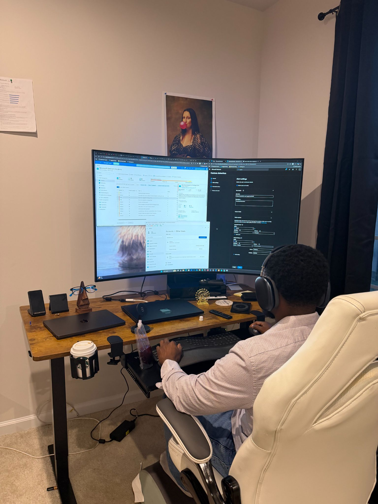

# About — from original portfolio

EBPRACTICELAB

## Welcome to My Workspace!

I’m Ebenezer Yiadom, a SOC Analyst driven by a lifelong curiosity for technology and a commitment to defense.

My journey started with the basics—learning to type with Mavis Beacon and figuring out how to fix computers just by playing with them. But my focus shifted entirely to cybersecurity when I first encountered phishing emails and 419 scams. The desire to protect my family, my friends, and eventually my clients became my primary motivator.

I am largely self-taught. While it was difficult, that drive to learn helped me land my first IT role on a Help Desk Analyst role, which paved the way into my first SOC role later. The SOC environment accelerated my learning and pushed me to dive even deeper into advanced cybersecurity concepts.

While my time in the SOC has taught me a lot, cybersecurity is an ever-evolving field where continuous learning is the only way to stay sharp. I've identified specific areas where I want to grow, which is why I am heavily focused on hands-on application. By actively participating in communities and technical courses, my goal is to step away from pure theory and spend more time executing practical, real-world engineering.

### Skills :

Core Security Operations

- SIEM & SOAR: Microsoft Sentinel (KQL), Splunk (SPL), SOAR Playbooks.
- Endpoint & XDR: Microsoft Defender XDR, CrowdStrike, Carbon Black.
- Threat Detection: MITRE ATT&CK Framework, Threat Hunting, Incident Response.

Cloud & Identity

- Cloud Security: Azure, AWS (CloudTrail, Security Hub), Defender for Cloud.
- Identity: Microsoft Entra ID (Identity Protection), IAM, PAM.

Analysis & Automation

- Automation: Python, PowerShell Scripting.
- Forensics & Analysis: Email Header Analysis, Malware Analysis, Joe Sandbox, CyberChef.

### Certifications:

- CompTIA CySA plus
- CompTIA Security Plus
- CompTIA Pentest Plus
- Microsoft SC-200
- Microsoft  SC-100
- Microsoft Azure AI Fundamentals
- AWS Certified Solutions Architect- Associate

[Portfolio index](README.md)
