# Cloud Storage Phishing — Email Header & Payload Analysis

**Original page title:** Email Header Analysis -  Cloud Storage Phishing Email leads to credential harvesting & potential identity theft  
**Date shown on original site:** Not specified  
**Evidence:** 15 screenshots from the published site

> **Migration note:** Text and image order are transcribed from the PUBLISHED Google Sites export dated October 30, 2026. The original lab conclusions are preserved as written and have not been independently revalidated. Review screenshots for personal or sensitive data before publishing.

## Original lab write-up

**Objective:** To conduct a comprehensive analysis of a suspicious "Billing Failure" email by analyzing raw SMTP headers to identify the originating infrastructure, and securely detonating the embedded payload within an isolated sandbox environment to map the complete attack chain and adversary objectives.

**Context:** An unsolicited email was received claiming a 2TB "Premium Cloud" subscription payment had failed. The message leveraged high-pressure social engineering tactics, stating the account was in "Pending Deletion" and threatening permanent, irreversible data loss if payment details were not updated within 24 hours. The email lacked any specific branding from a legitimate cloud provider.

### Phase 1: Static Header Analysis

### An inspection of the raw email headers revealed several classic indicators of burner phishing infrastructure and defense evasion techniques:

### Phase 2: Static Header Analysis

An inspection of the raw email headers revealed several classic indicators of burner phishing infrastructure and defense evasion techniques:

- **Sender Obfuscation:** The "From" address utilized MIME Encoded-Word syntax (=?UTF-8?...) to obscure the display name. This technique is deliberately used by threat actors to blind basic string-matching spam filters that might flag keywords like "Cloud Storage Alert."
- **Infrastructure Tracing:** The first external hop (95.154.235.136) originated from Iomart Managed Services (RapidSwitch), a commercial data center in the UK. This indicates the adversary utilized a rented Virtual Private Server (VPS), VPN or compromised cloud infrastructure to launch the campaign, rather than a residential IP.
- **Authentication & Domain Age:** While the email passed DKIM and DMARC checks, it failed SPF. Further OSINT investigation into the sending domain (rveband.com) revealed it was registered only three months prior. The primary domain in the redirect chain was created four months prior, a strong indicator of disposable attacker infrastructure.

### Phase 3: Dynamic Payload Detonation & Attack Chain Mapping

To safely observe the email's behavior and the attacker's ultimate goal, the embedded URL was extracted and detonated within a secure, isolated cloud browser session in this case, ("browser.lol" for free analysis).

The analysis revealed a sophisticated, multi-stage redirection scheme, designed to potentially harvest credentials, financial data and identity:

- **Stage 1 (Intermediary Redirection):** The initial link routed to a domain named prizeswin.com. This page executed a fake "verification" script (displaying checks for Location, User Info, and Entry Status) to build a false sense of legitimacy.
- **Stage 2 (The Lure):** The session was then redirected to secure.totaldrive.com. The page displayed a fraudulent offer for discounted cloud storage services, prompting the user to check out via a prominent PayPal button.
- **Stage 3 (Credential Harvesting):** Clicking the payment button initiated a redirect to a highly convincing, spoofed PayPal portal. The site was engineered to capture data regardless of user action; both the "Sign In" and "Create an Account" workflows immediately prompted the victim for Personally Identifiable Information (PII), billing addresses, and full bank/credit card details.
- Conclusion This campaign demonstrates a well-orchestrated credential harvesting operation. By combining psychological urgency with obfuscated routing and multi-stage redirects, the adversary aimed to bypass email security gateways to commit identity theft and financial fraud.

## Screenshots (original order)

Show all 15 screenshots

**Screenshot 01**

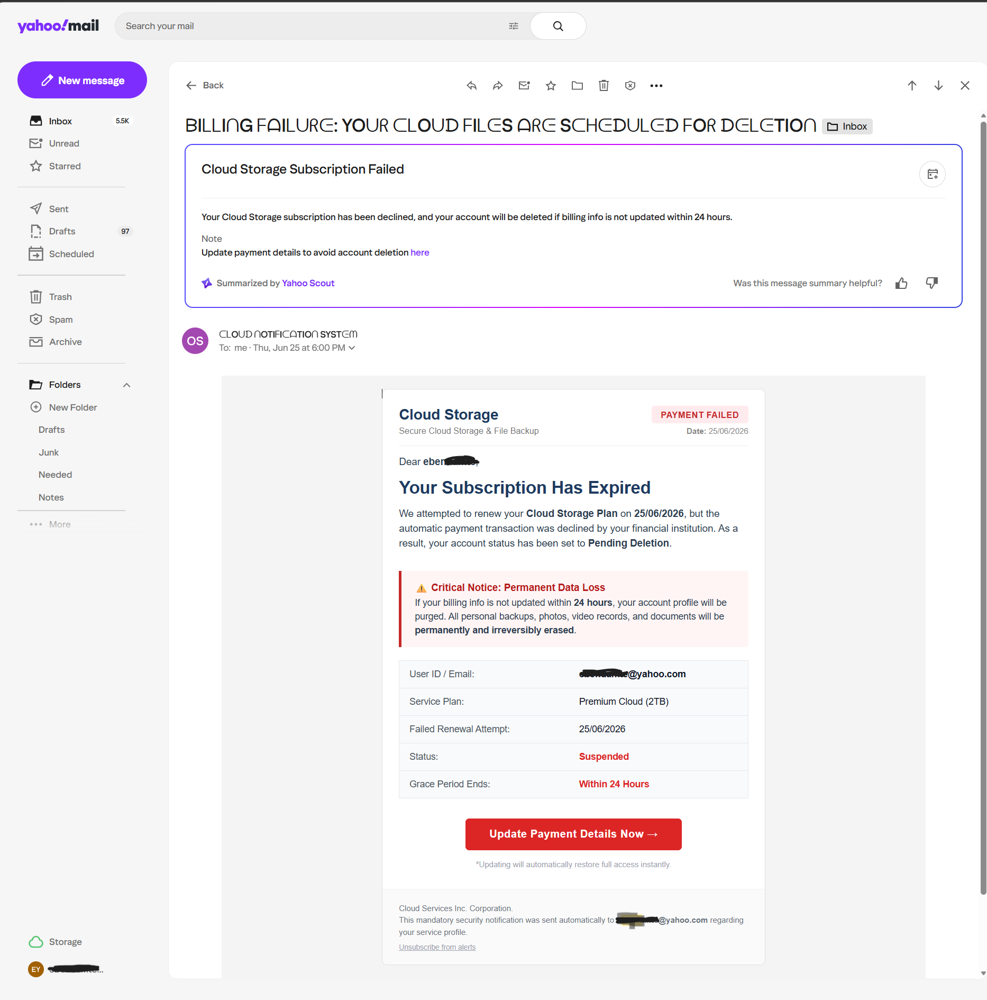

**Screenshot 02**

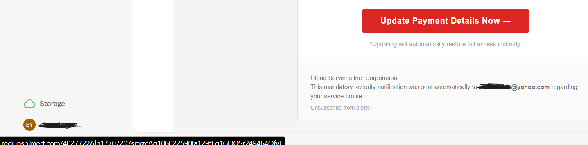

**Screenshot 03**

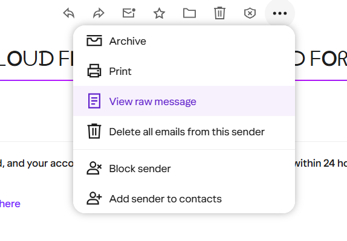

**Screenshot 04**

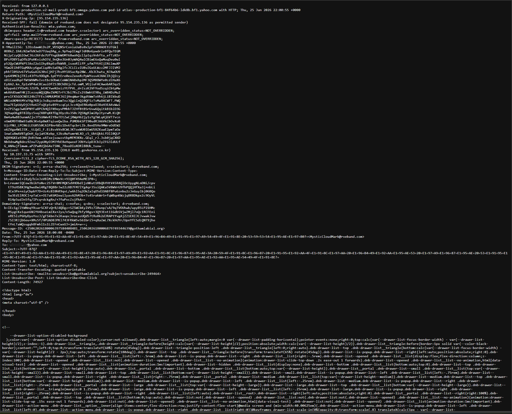

**Screenshot 05**

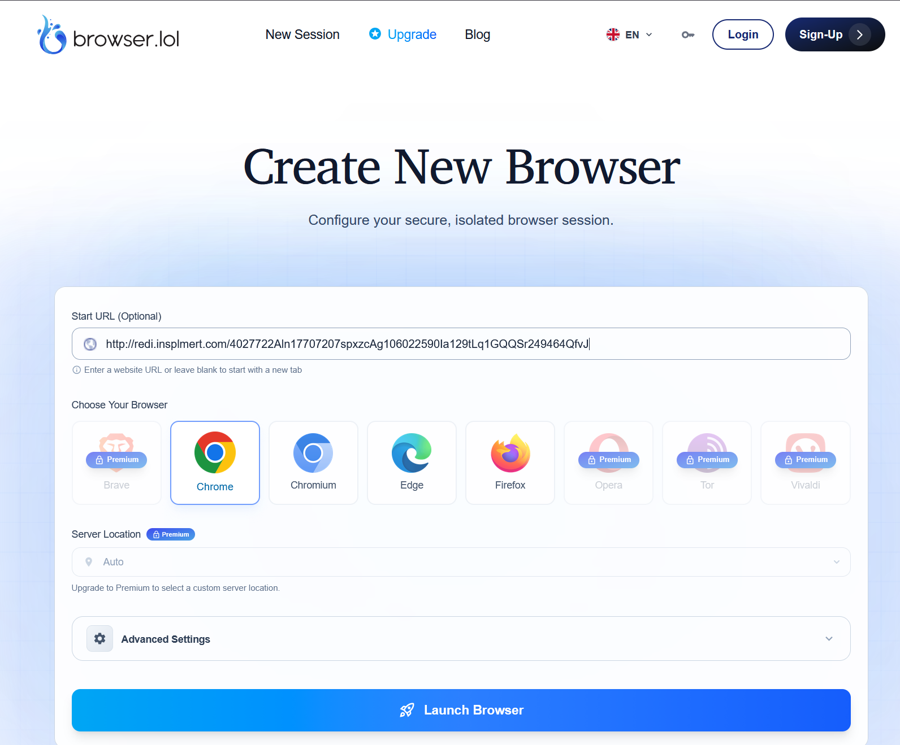

**Screenshot 06**

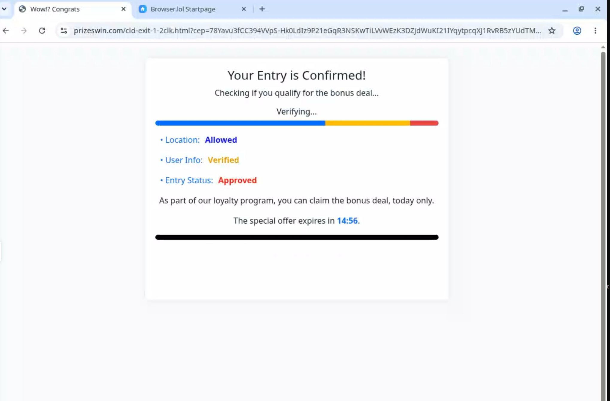

**Screenshot 07**

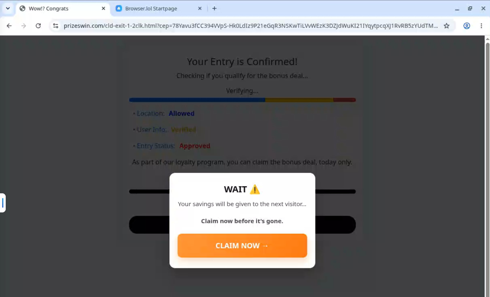

**Screenshot 08**

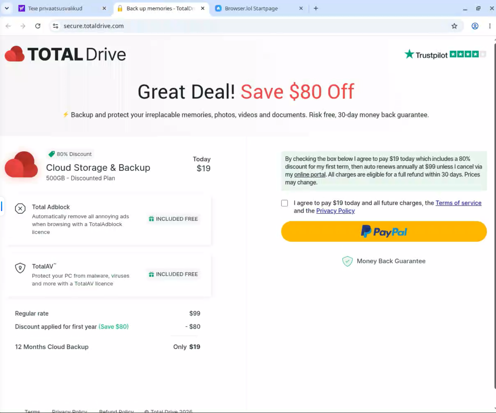

**Screenshot 09**

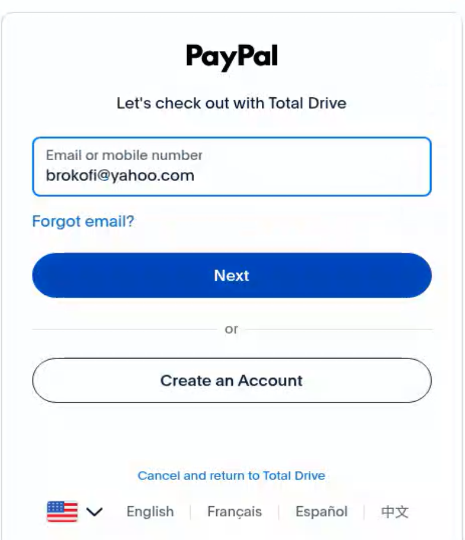

**Screenshot 10**

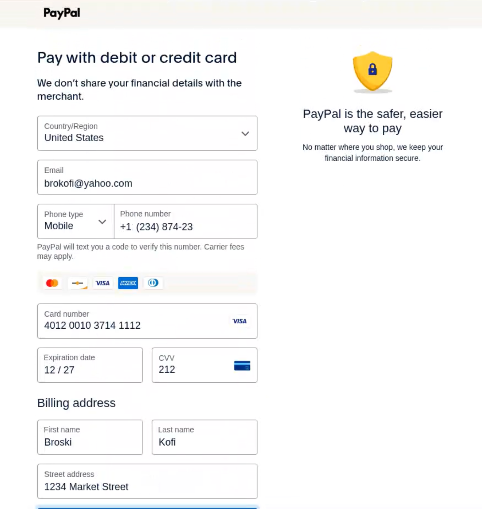

**Screenshot 11**

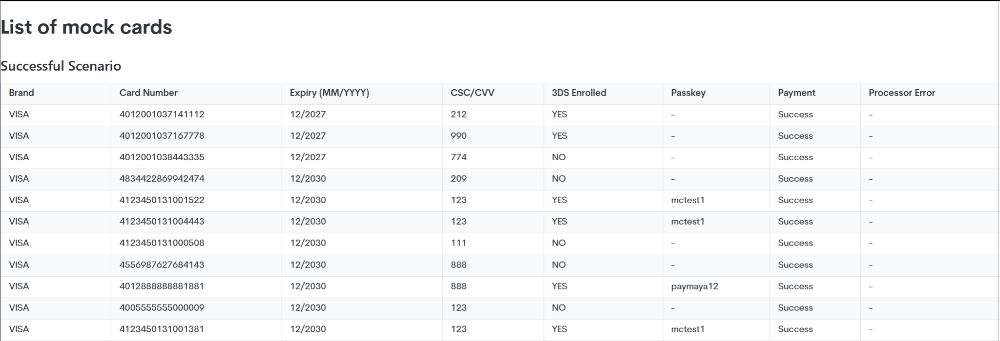

**Screenshot 12**

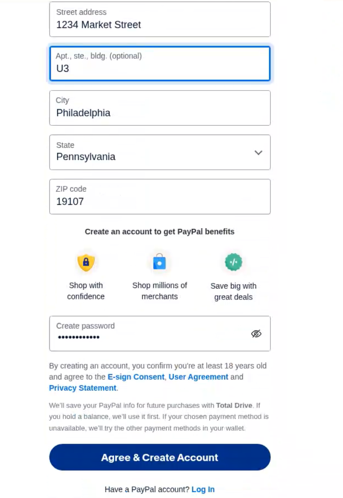

**Screenshot 13**

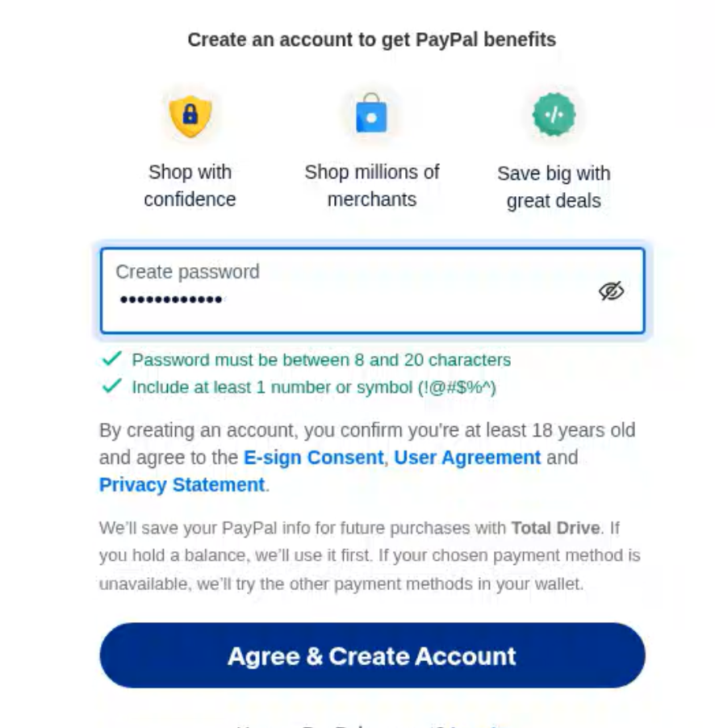

**Screenshot 14**

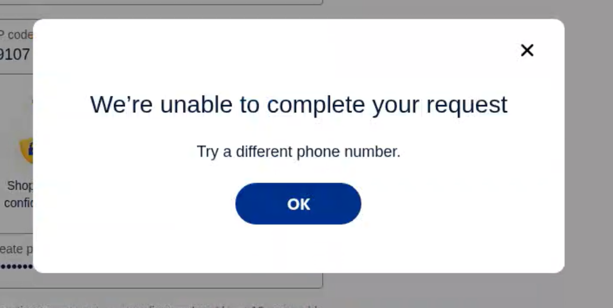

**Screenshot 15**

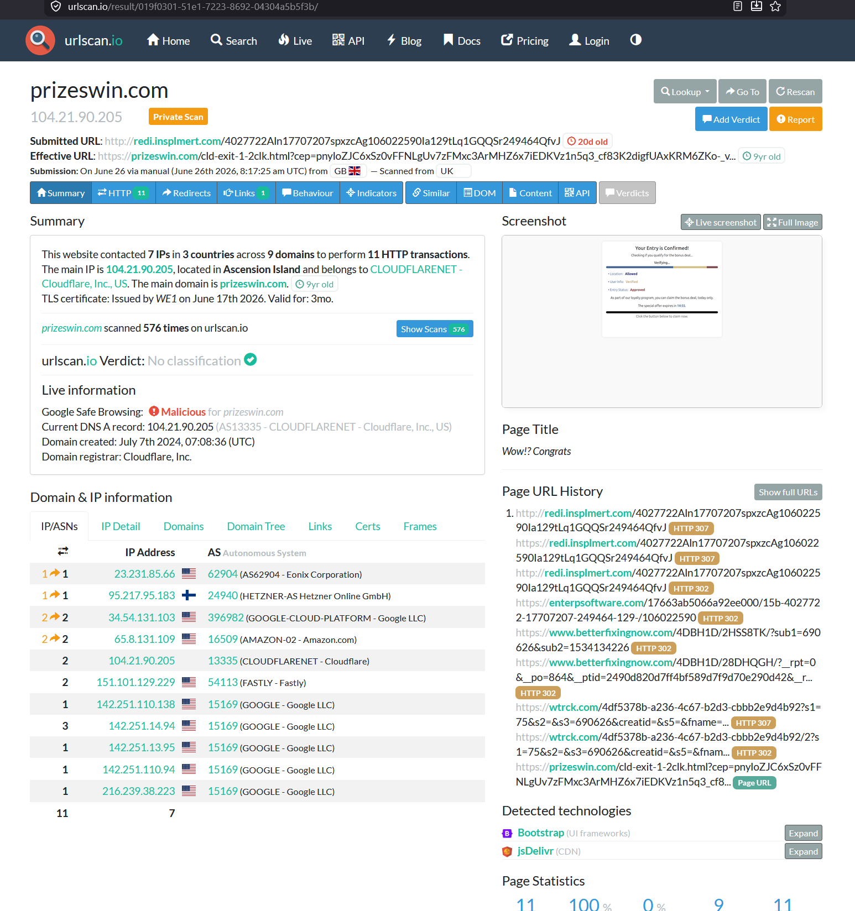

---

[Back to portfolio index](../../README.md)
