# Basic Sentinel Playbooks via Logic Apps

**Original page title:** Basic PlayBook Automations via Logic Apps in Sentinel (March, 2026)  
**Date shown on original site:** March 2026  
**Evidence:** 15 screenshots from the published site

> **Migration note:** Text and image order are transcribed from the PUBLISHED Google Sites export dated October 30, 2026. The original lab conclusions are preserved as written and have not been independently revalidated. Review screenshots for personal or sensitive data before publishing.

## Original lab write-up

**Objective:** Implement basic Security Orchestration, Automation, and Response (SOAR) workflows to reduce manual triage fatigue and accelerate incident response times.

- **Workflow Orchestration:** Utilized Azure Logic Apps—a cloud-based platform for orchestrating processes without extensive code—to build Microsoft Sentinel Playbooks.
- **Dynamic Alerting:** Configured playbooks to automatically extract dynamic incident details (Alert Title, Severity, Entities) and push them via webhook to Microsoft Teams and Outlook, allowing for immediate, at-a-glance triage before even opening the SIEM.
- **Auto-Remediation Testing:** Engineered an automation rule to automatically close known-benign incidents generated by my custom "Any Account Sign-In" lab rule, successfully demonstrating automated noise-reduction techniques.

I need to practice some more, but I wanted to get initial hands-on experience about automating these and its capabilities.

## Screenshots (original order)

Show all 15 screenshots

**Screenshot 01**

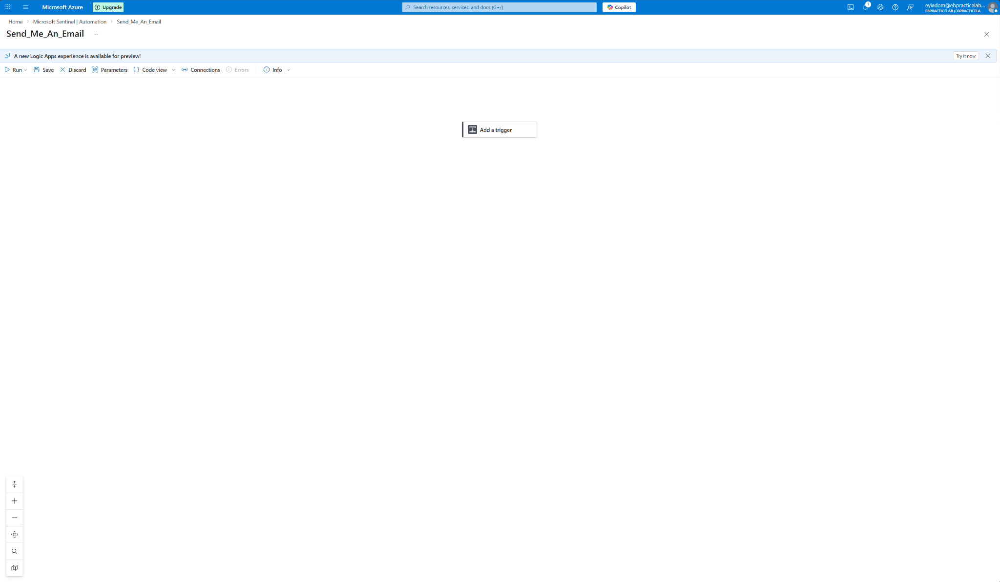

**Screenshot 02**

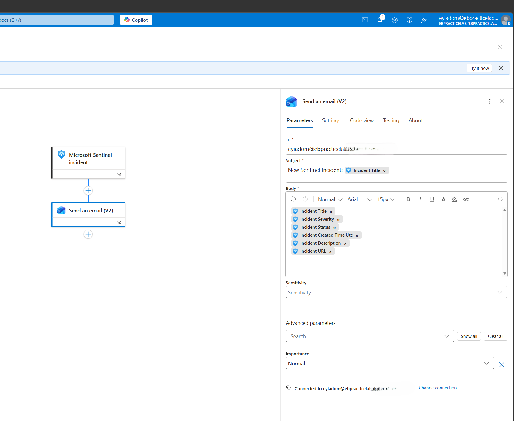

**Screenshot 03**

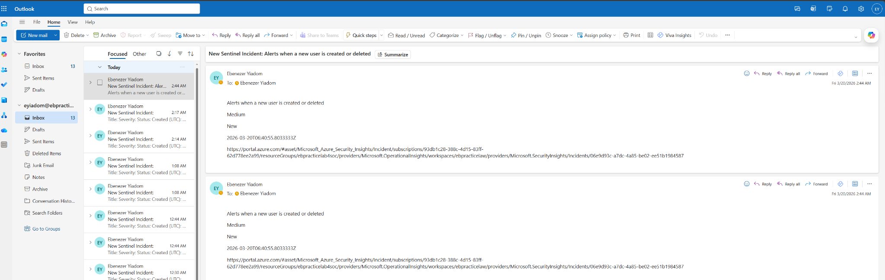

**Screenshot 04**

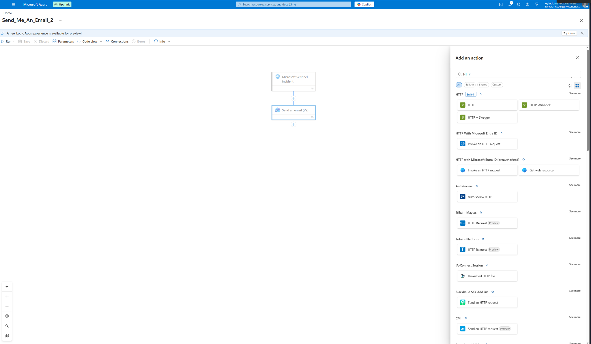

**Screenshot 05**

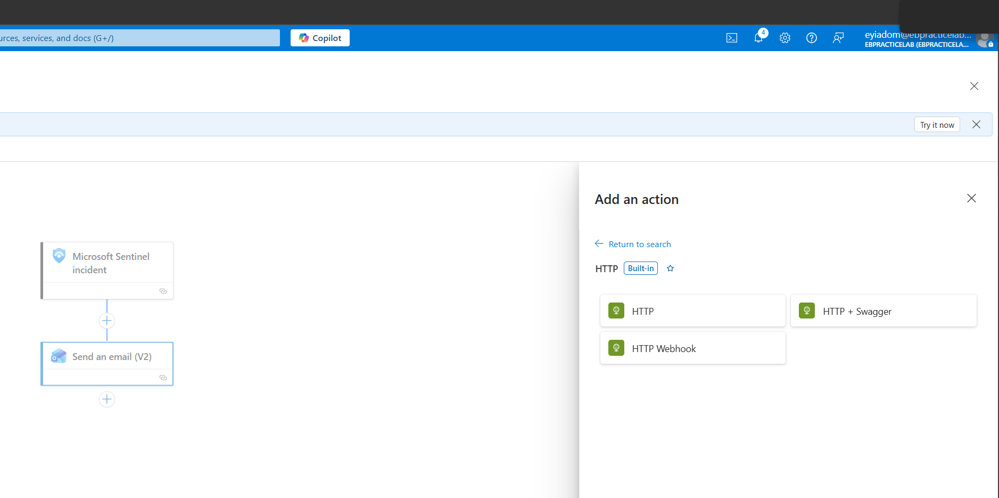

**Screenshot 06**

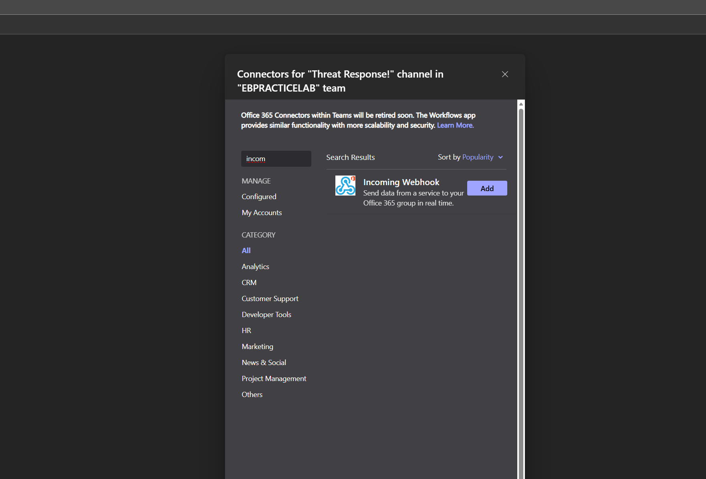

**Screenshot 07**

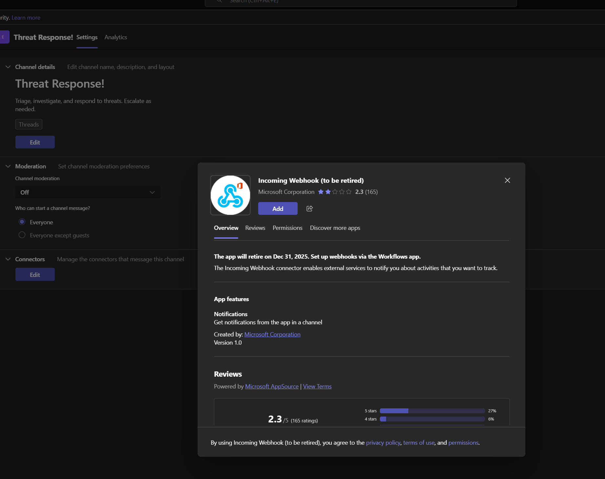

**Screenshot 08**

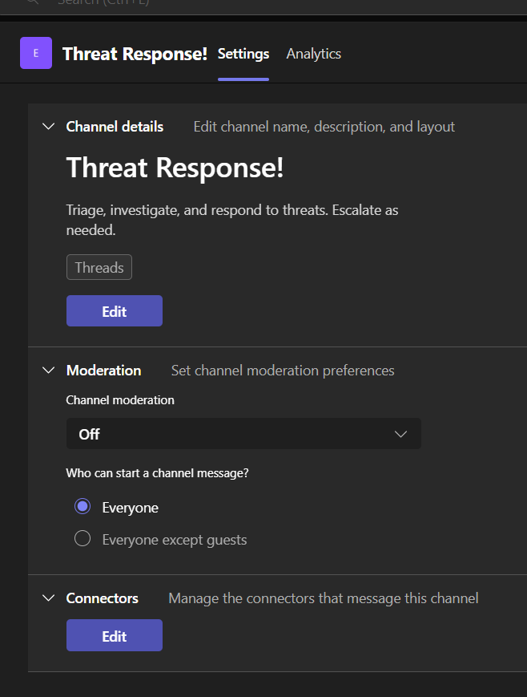

**Screenshot 09**

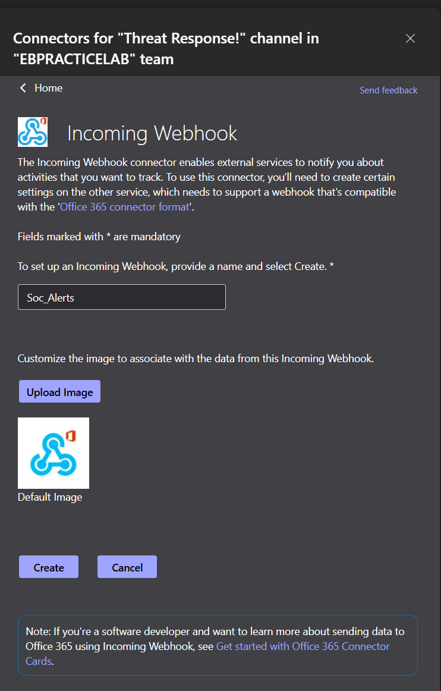

**Screenshot 10**

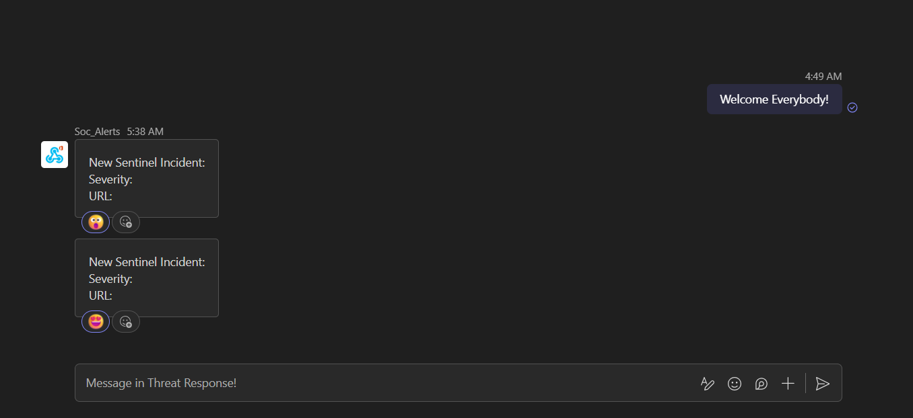

**Screenshot 11**

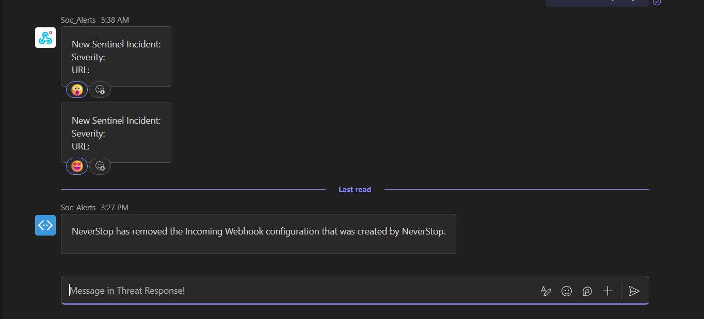

**Screenshot 12**

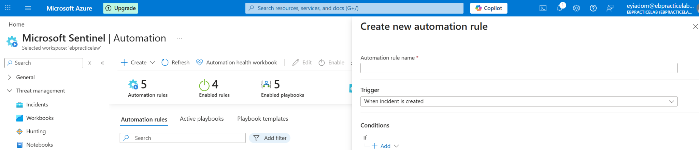

**Screenshot 13**

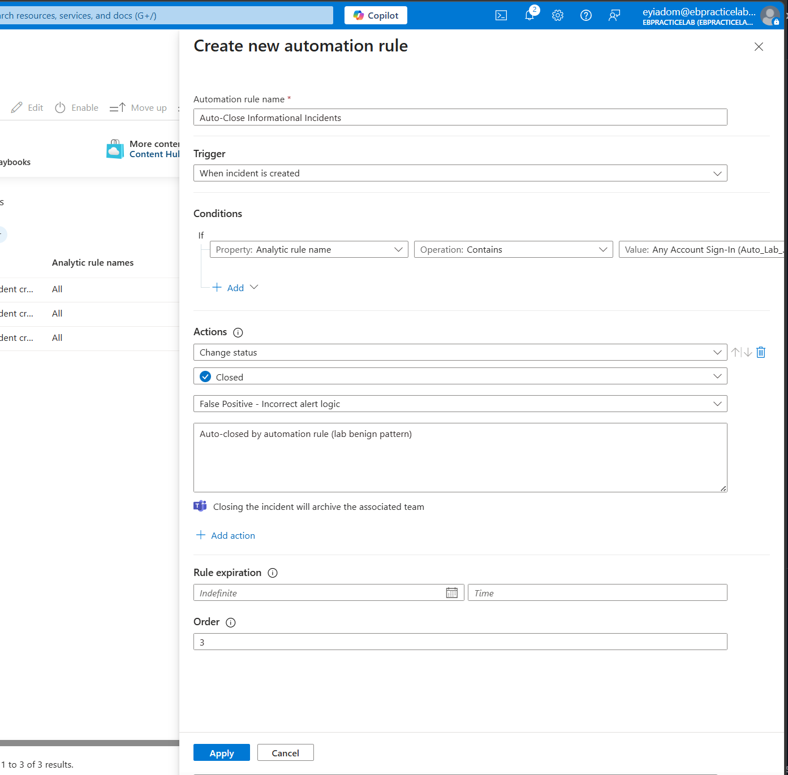

**Screenshot 14**

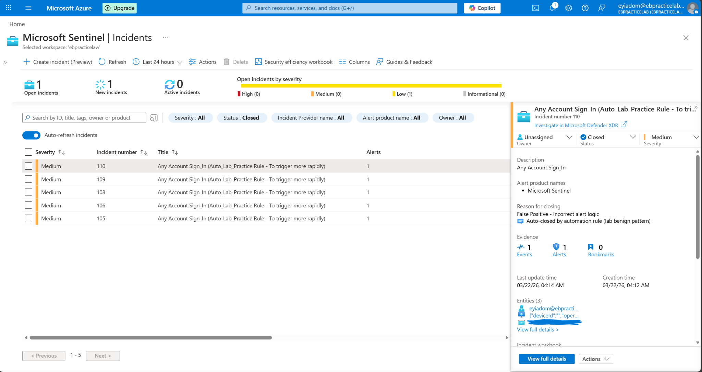

**Screenshot 15**

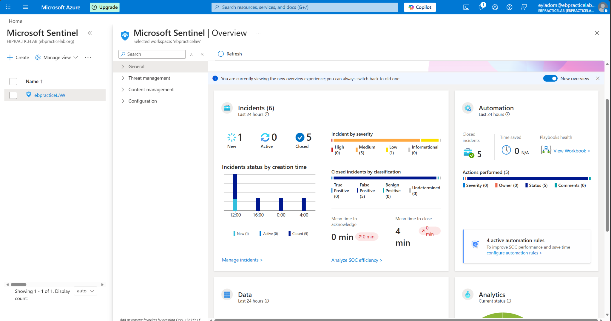

---

[Back to portfolio index](../../README.md)
