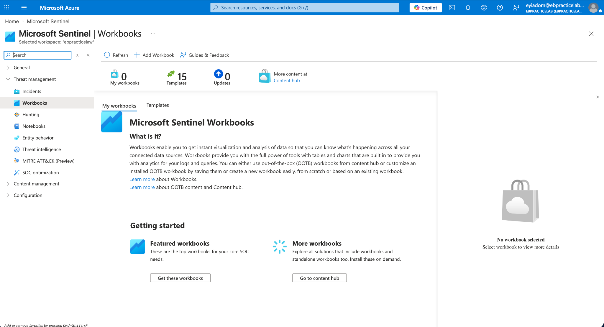
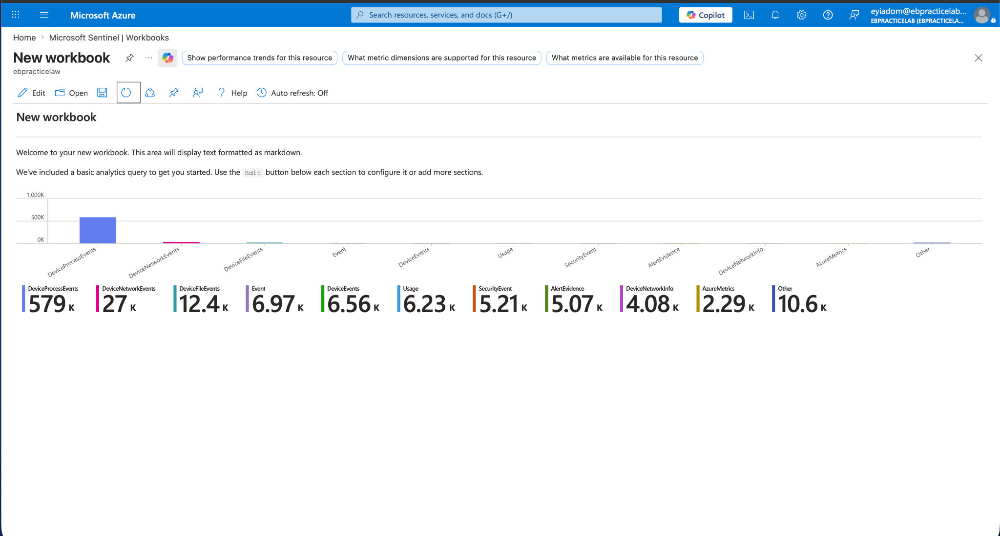
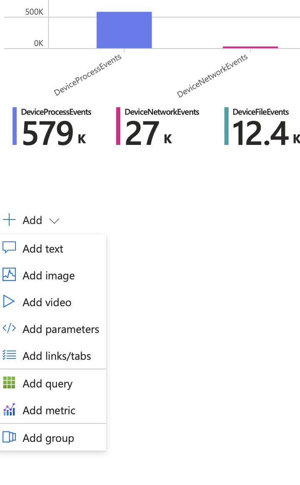
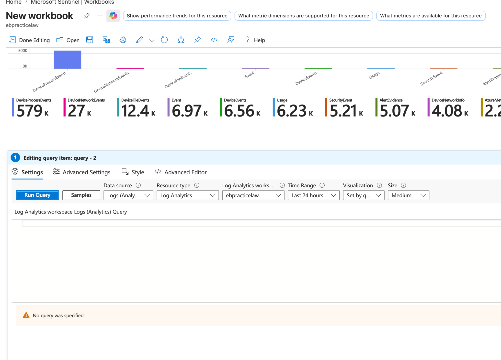
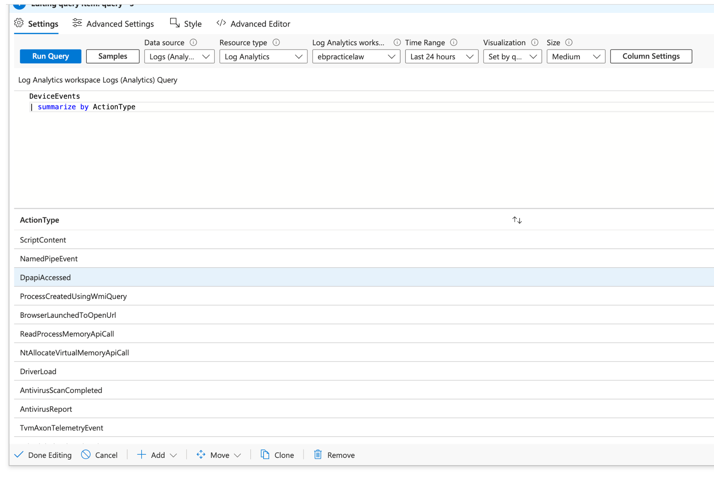
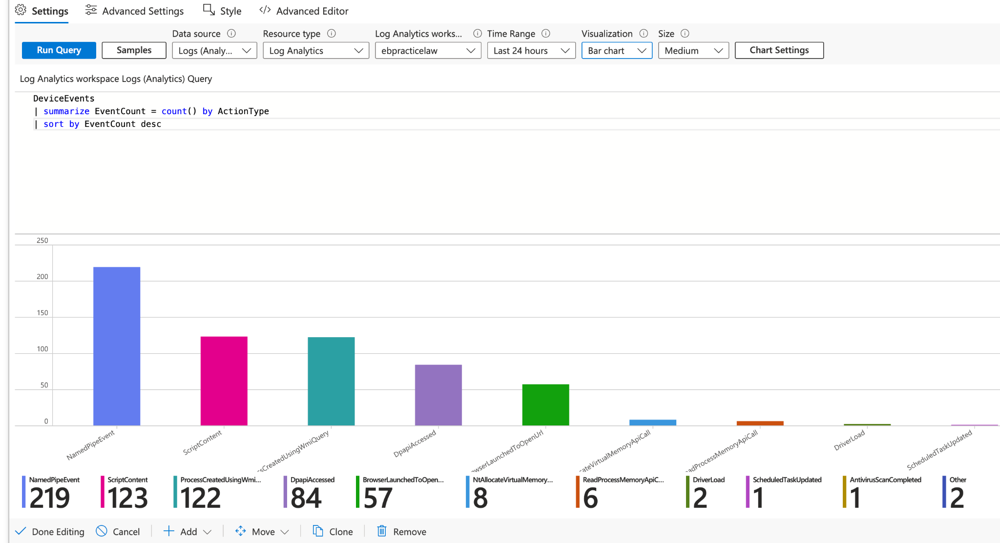
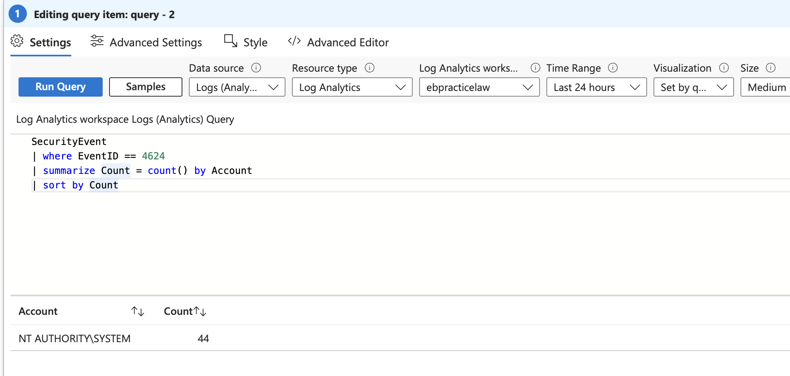
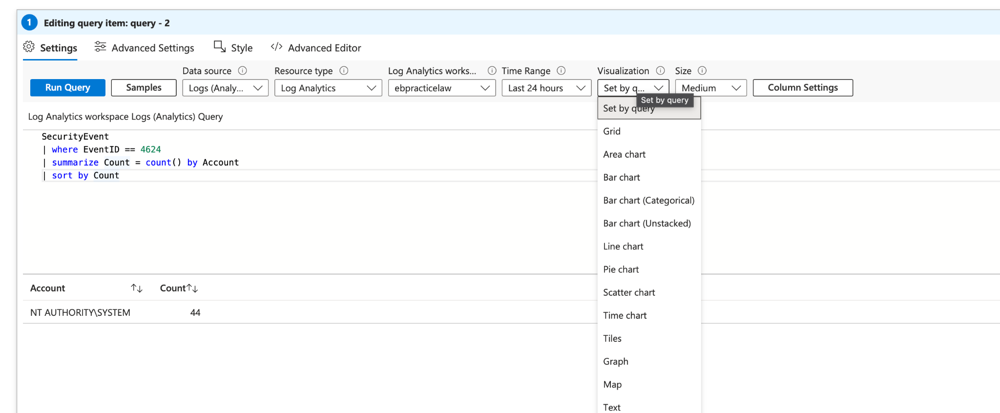
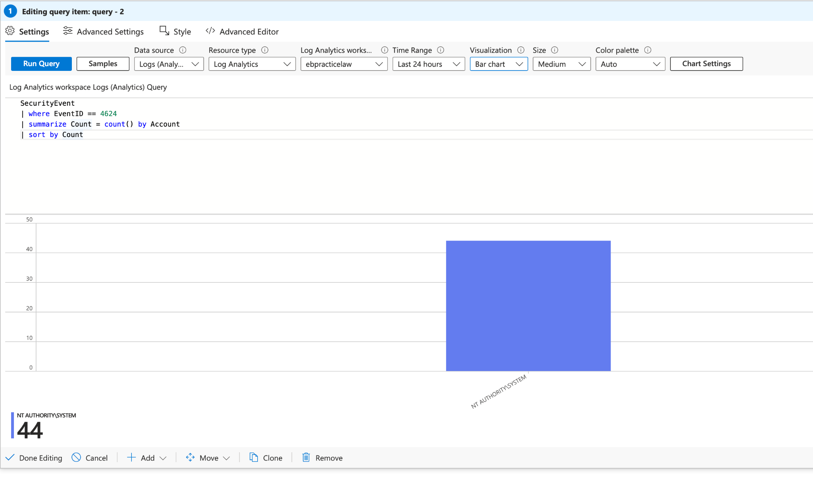

# Microsoft Sentinel Workbooks

**Original page title:** Azure Sentinel Workbooks  
**Date shown on original site:** Not specified  
**Evidence:** 9 screenshots from the published site

> **Migration note:** Text and image order are transcribed from the PUBLISHED Google Sites export dated October 30, 2026. The original lab conclusions are preserved as written and have not been independently revalidated. Review screenshots for personal or sensitive data before publishing.

## Original lab write-up

**Objective:** Build dynamic, visual dashboards to accelerate threat hunting and log analysis by transforming raw SIEM telemetry into actionable intelligence.

- **The Framework:** Azure Workbooks provide a highly flexible canvas for complex data analysis and visual reporting directly within the Microsoft Sentinel environment.
- **Dashboard Engineering:** Instead of manually querying raw logs for every investigation, I made custom workbooks to visualize security metrics. Specifically, I developed dashboards tracking ActionTypes within DeviceEvents and aggregated event counts for broad Windows SecurityEvents.

## Screenshots (original order)

Show all 9 screenshots

**Screenshot 01**

**Screenshot 02**

**Screenshot 03**

**Screenshot 04**

**Screenshot 05**

**Screenshot 06**

**Screenshot 07**

**Screenshot 08**

**Screenshot 09**

---

[Back to portfolio index](../../README.md)
