# Wazuh XDR/SIEM Lab — Ubuntu Server & Windows 11 Agent Onboarding

**Project status:** Initial deployment and Windows endpoint telemetry ingestion completed; Sysmon integration and deeper detection exercises planned.  
**Lab platform:** Oracle VirtualBox | Ubuntu Server VM | Windows 11 Pro VM | Wazuh 4.14 installation series  
**Captured:** October 30–31, 2026

> **Project summary:** After working with Microsoft Sentinel and Microsoft Defender in my personal SOC lab, I decided to explore a free, open-source security platform. I deployed the Wazuh manager, indexer, and dashboard on an Ubuntu virtual machine, onboarded a Windows 11 endpoint agent, and verified that Windows security-related events were reaching the Wazuh interface. This write-up covers the initial setup and observations—not a completed threat simulation or custom detection rule.

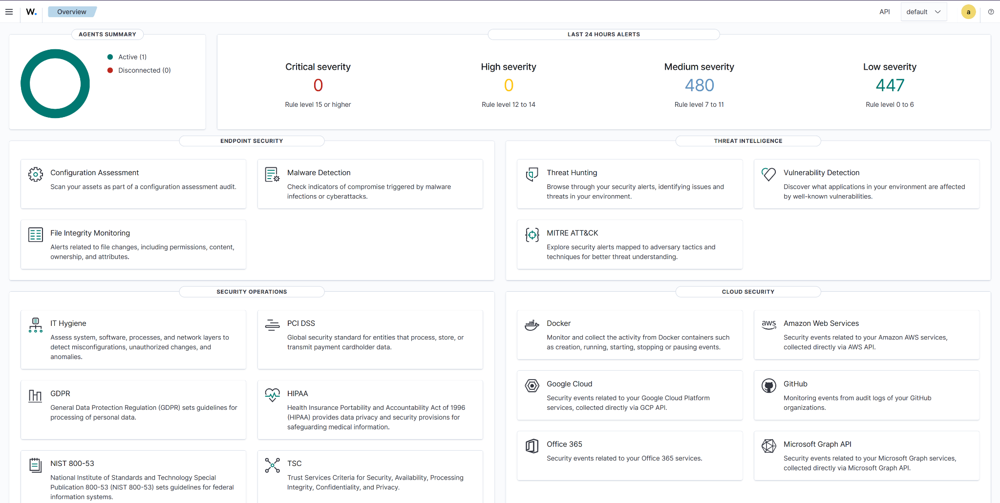

## Objectives

- Build a self-hosted security monitoring environment using Wazuh's SIEM/XDR capabilities.
- Install and access the Wazuh central components on Ubuntu Server.
- Connect to the Ubuntu server from my physical Windows host through SSH.
- Register and validate a Wazuh agent on a Windows 11 virtual machine.
- Examine initial security alerts, endpoint details, and ingested Windows event telemetry.
- Prepare the environment for later Sysmon integration, threat hunting, and detection testing.

## Lab environment

| Component | Implementation | Evidence / notes |
| --- | --- | --- |
| Virtualization | Oracle VirtualBox | VM network port forwarding shown below |
| Wazuh server | Ubuntu Linux virtual machine | Wazuh indexer, manager, Filebeat, and dashboard initialized by installation assistant |
| Administrative workstation | Windows physical host using PowerShell and web browser | SSH and dashboard accessed through localhost port forwarding |
| Windows endpoint | Windows 11 Pro VM | Agent `001`, shown as active |
| Wazuh agent | v4.14.9 | Version appears in endpoint inventory |
| Network access | VirtualBox NAT and local host port forwarding | SSH `127.0.0.1:2222` to guest port `22`; dashboard `127.0.0.1:8443` to guest port `443` |
| Endpoint event exploration | Wazuh **Discover** / `wazuh-alerts-*` | Query returned 927 hits in a screenshot's selected 24-hour period |

The screenshot shows the VirtualBox NAT guest address as `10.0.2.15` and the Windows agent's reported private IP as `192.168.217.4`. These values are from this specific lab and should not be copied blindly into another environment. The exact network path used for **agent-to-manager communication** is not documented in the screenshots; the NAT rules below show access for SSH and the dashboard.

## 1. Review the Wazuh installation documentation

I began at the [official Wazuh website](https://wazuh.com/) and opened **Install Wazuh → Quickstart**. The Quickstart guide provides an all-in-one installation assistant for the central Wazuh components. This was the approach I used for my initial lab.

<details>
<summary>View official website and Quickstart screenshots</summary>

**Wazuh website**  
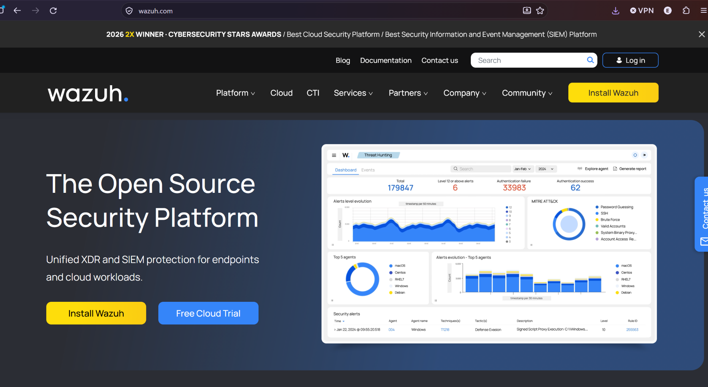

**Quickstart and installation guide navigation**  
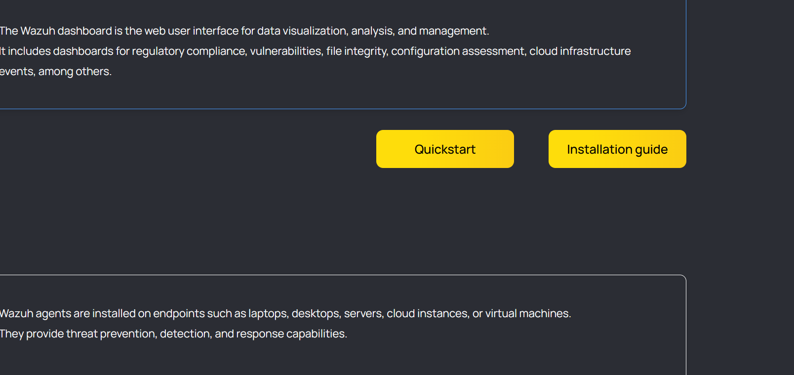

**Installation command documented in Quickstart**  
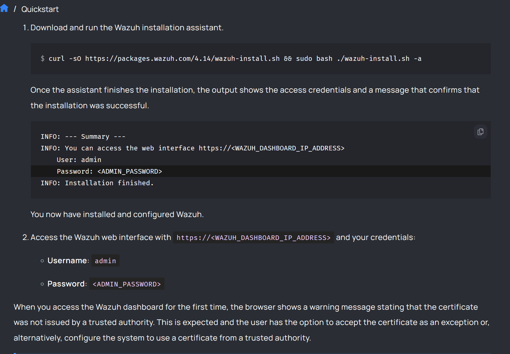

</details>

## 2. Access Ubuntu through SSH and configure VirtualBox networking

Rather than working only inside the Ubuntu VM console, I used **PowerShell on my physical Windows host** as my SSH client. My screenshots show an initial connection refused error while testing the local port mapping; a later screenshot confirms I obtained an Ubuntu shell. The precise fix for the earlier error was not captured, so I am not attributing it to a specific cause.

The local SSH command used the host-loopback address and the forwarded SSH port:

```powershell
ssh -p 2222 <ubuntu-username>@127.0.0.1
```

The VirtualBox NAT port forwarding screenshot documents two rules:

| Purpose | Host address and port | Guest address and port |
| --- | --- | --- |
| SSH | `127.0.0.1:2222` | `10.0.2.15:22` |
| Wazuh dashboard | `127.0.0.1:8443` | `10.0.2.15:443` |

These rules let the physical host access services inside the Ubuntu virtual machine. They are not, by themselves, a complete description of how the Windows agent reaches the Wazuh manager.

<details>
<summary>View SSH and networking screenshots</summary>

**Early SSH connection error**  
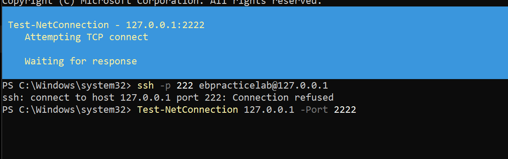

**Ubuntu shell accessed from the host**  
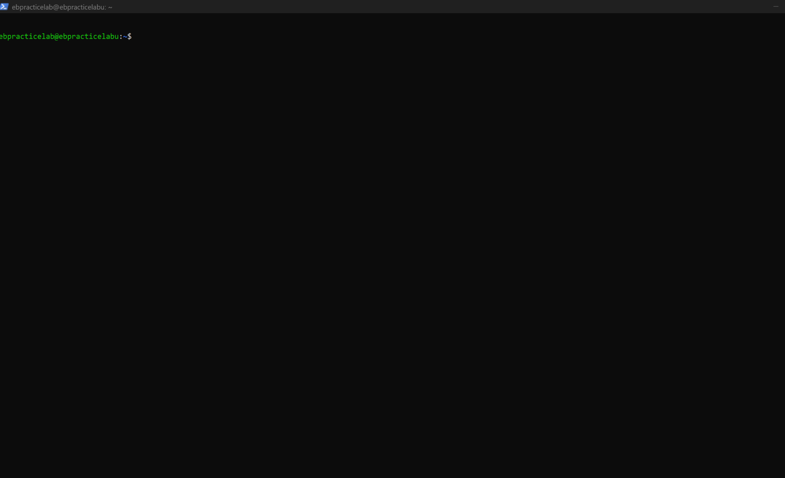

**VirtualBox NAT port forwarding rules**  
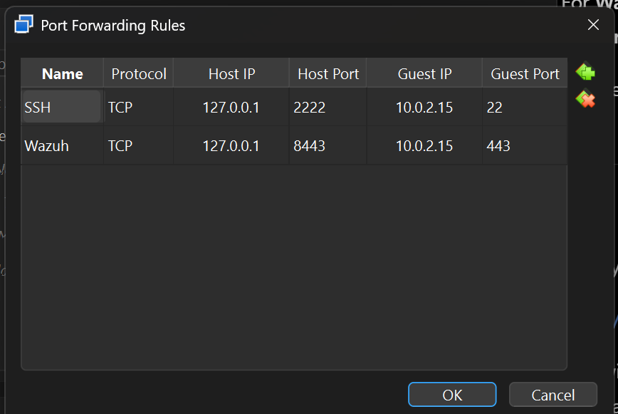

</details>

## 3. Install the Wazuh central components on Ubuntu

From the Ubuntu terminal, I ran the installation assistant command shown in the Wazuh 4.14 Quickstart documentation:

```bash
curl -sO https://packages.wazuh.com/4.14/wazuh-install.sh && sudo bash ./wazuh-install.sh -a
```

The `-a` option starts the all-in-one installation path. The installer output shows installation and initialization of the **Wazuh indexer**, **Wazuh manager**, **Filebeat**, and **Wazuh dashboard**.

**Troubleshooting encountered:** My first captured attempt reached dashboard installation but ended with a **Wazuh dashboard installation failed** message. The assistant then removed the partially installed components. A subsequent installation attempt completed successfully. The screenshots do not establish the root cause of the first attempt, so I have left that unresolved rather than inventing a fix.

The successful run displayed the dashboard URL, admin username, and an automatically generated password. **The password is redacted in the accompanying screenshot**, and it should be rotated following its exposure in the original installation capture.

<details>
<summary>View installation and troubleshooting screenshots</summary>

**Running the installation assistant**  
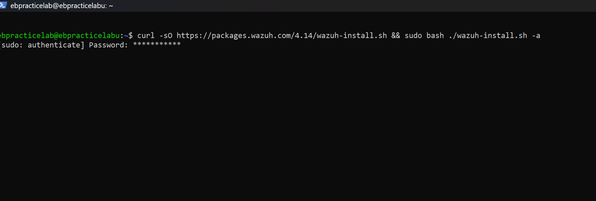

**Initial attempt failed during dashboard installation**  
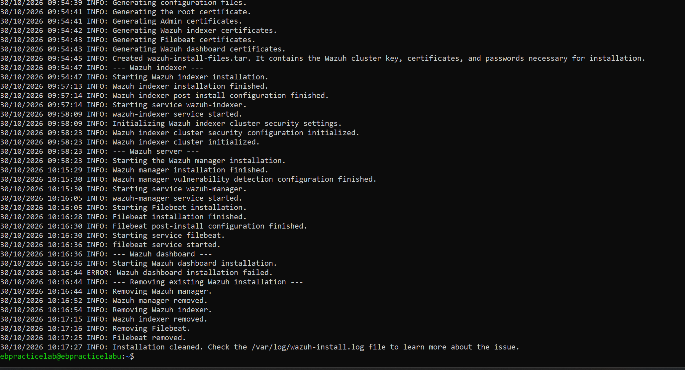

**Successful retry — admin password removed from image**  
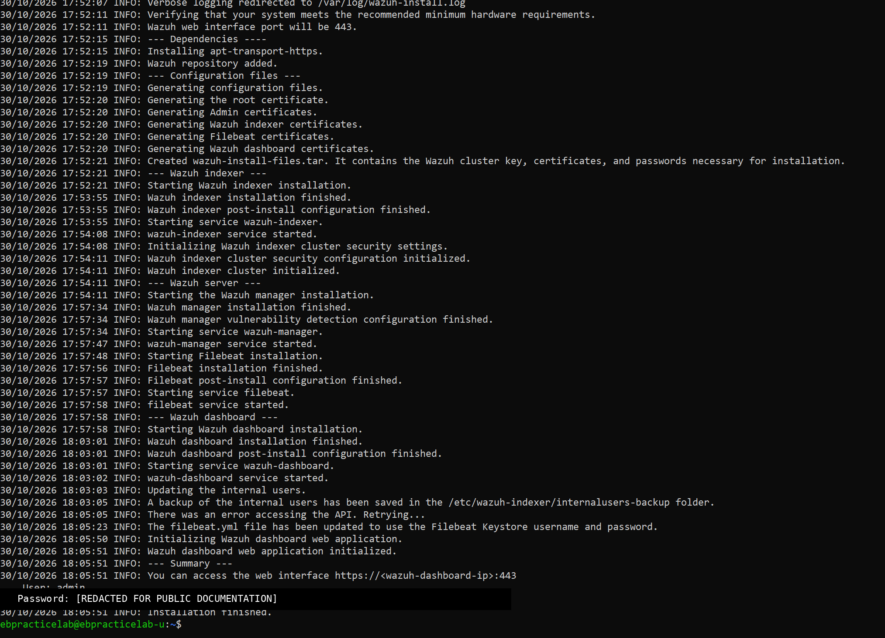

</details>

## 4. Access the Wazuh dashboard

After installation, I used the VirtualBox dashboard port forward and visited:

```text
https://127.0.0.1:8443
```

The Wazuh login page loaded, and I was able to authenticate and reach the overview dashboard. Before the Windows agent was onboarded, one screenshot showed **no registered agents**. Security-alert counts were already visible in that view, but this screenshot alone does not establish which component generated them.

<details>
<summary>View dashboard login and initial state</summary>

**Wazuh login screen**  
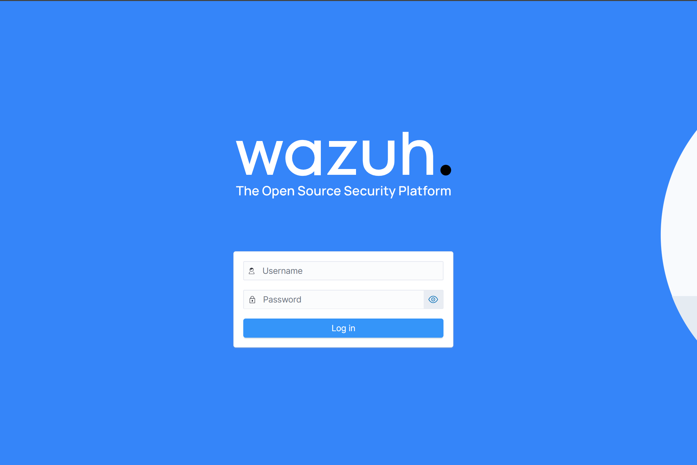

**Dashboard showing no registered agents**  
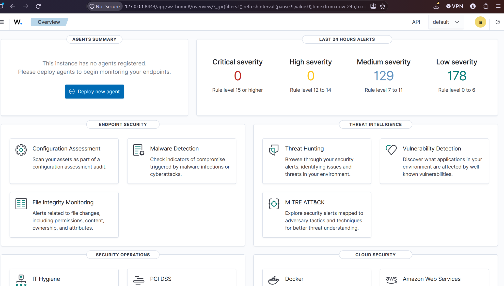

</details>

## 5. Deploy the Wazuh agent to Windows 11

With the dashboard running, I continued to **Endpoints → Deploy new agent** and chose **Windows (MSI, 32/64 bits)**. The deployment wizard asks for the manager/server address and offers optional settings such as the agent name and group before providing commands for installation and starting the agent service.

The provided screenshot captures the wizard **before its server-address field was filled in**, so the exact generated MSI command is not reproduced here. I subsequently installed the agent on the Windows 11 VM and confirmed it appeared in Wazuh.

I also enabled **Remote Desktop** in the Windows 11 Pro VM to make interacting with the endpoint easier from my host.

<details>
<summary>View Windows agent deployment and RDP screenshots</summary>

**Windows agent installation wizard**  
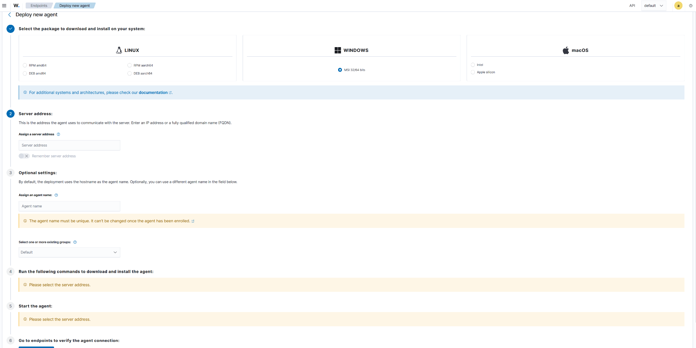

**Enabling Remote Desktop on Windows 11**  
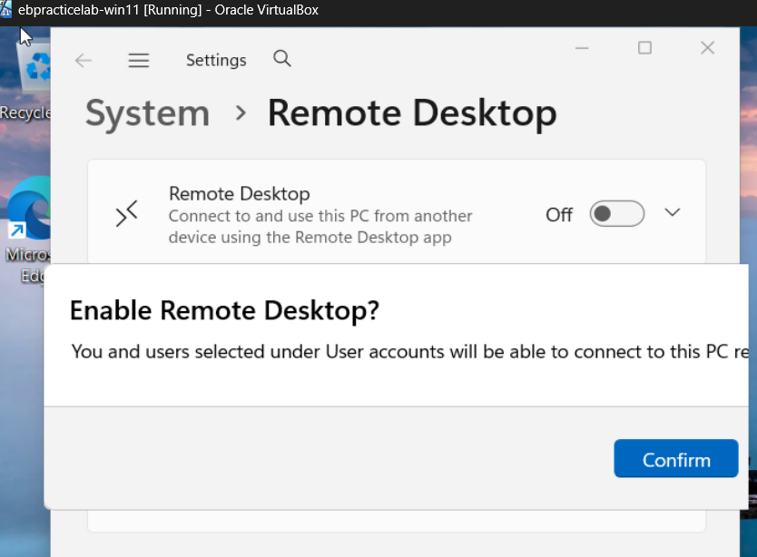

</details>

## 6. Verify agent registration and telemetry

The **Endpoints** page showed **one active Windows agent** with ID `001`, version **v4.14.9**, and the default agent group. The endpoint detail view identified the operating system as **Windows 11 Pro** and displayed sections for event activity, MITRE ATT&CK mappings, vulnerability detection, and security configuration assessment.

The overview screenshot shows alert counts for the selected last-24-hours period: **480 medium-severity** and **447 low-severity** alerts, with **zero high- or critical-severity** alerts. Those counts indicate Wazuh rule matches, not necessarily confirmed malicious activity.

To inspect actual ingested events, I opened **Discover** using the `wazuh-alerts-*` index pattern. The screenshot shows **927 hits** over the selected 24-hour window and Windows-related fields such as `agent.name`, `data.win.system.eventID`, `data.win.system.providerName`, and `data.win.system.message`. A visible example is **Windows Event ID 16384** from **Software Protection Platform Service**, which should not be interpreted as malicious without further supporting context.

On the endpoint details page, the **Security Configuration Assessment** panel shows a **CIS Microsoft Windows 11 Enterprise Benchmark v3.0.0** scan reporting **123 passed**, **350 failed**, **9 not applicable**, and a **26% score**. Although the agent is on Windows 11 Pro, that is the benchmark name displayed by the UI. It provides a configuration-assessment baseline, not evidence of a compromise. The vulnerability panel displayed zero counts at the time of capture; this alone is not proof that the machine has no vulnerabilities.

<details>
<summary>View connected agent, endpoint details, and Discover evidence</summary>

**One registered and active Windows agent**  
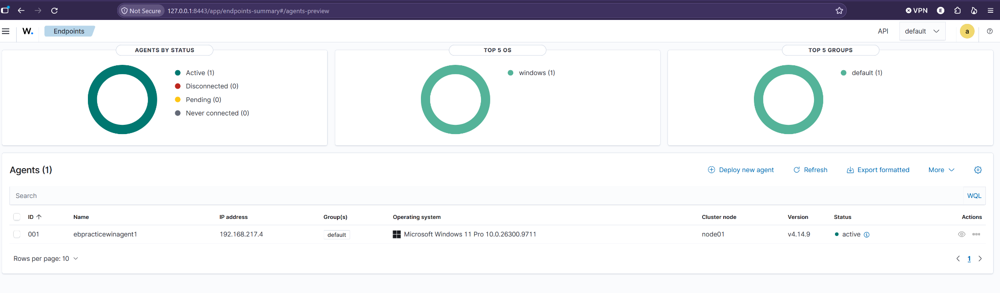

**Wazuh overview after agent onboarding**  


**Agent information, MITRE ATT&CK, and configuration assessment**  
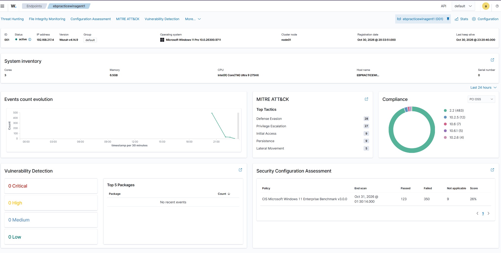

**Windows events visible in Discover**  
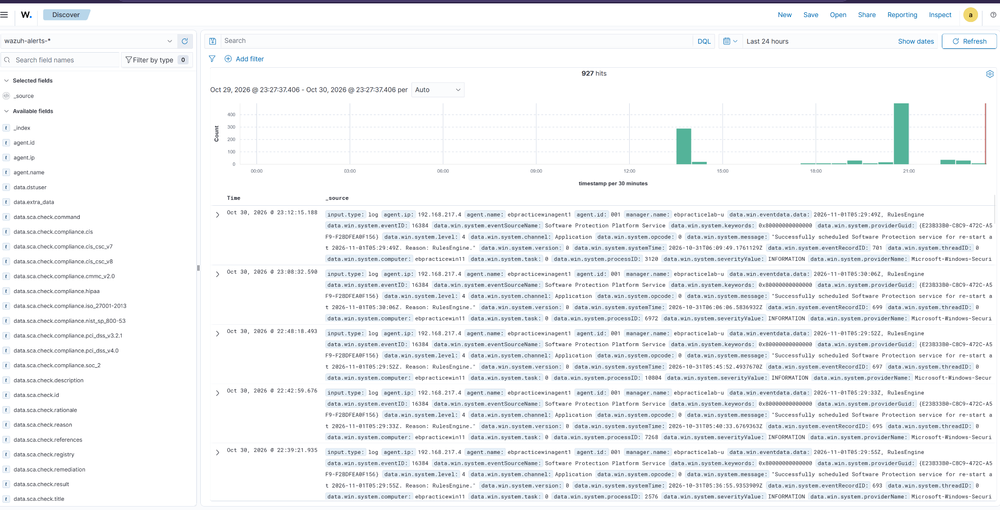

</details>

## 7. Results and lessons learned

| Goal | Observed outcome |
| --- | --- |
| Run self-hosted Wazuh on Ubuntu | **Completed:** Successful installation and login |
| Administer the Ubuntu VM remotely | **Completed:** Ubuntu shell and localhost access documented |
| Enroll a Windows 11 VM | **Completed:** Agent `001` reported active |
| Verify event ingestion | **Completed:** Windows records visible in Discover |
| Explore security posture panels | **Observed:** MITRE mappings, vulnerability panel, and SCA benchmark results visible |
| Integrate Sysmon | **Planned, not completed** |
| Test custom detection or active response | **Planned, not completed** |

**Key takeaways:** Wazuh gave me a functional open-source environment for endpoint visibility and SIEM investigation. The deployment also exposed a few practical configuration challenges: an SSH connection error, an unsuccessful first installer run, and the need to distinguish platform-generated alerts from actionable security incidents. I verified ingestion before moving on to deeper hunting or custom rules.

## 8. Next steps

1. Install **Sysmon** on the Windows VM and configure the Wazuh agent to collect its operational event channel.
2. Validate Sysmon events (including process creation and network connection events) in Discover.
3. Run controlled detection tests, document what telemetry is produced, and check whether existing Wazuh rules fire.
4. Explore rule tuning, custom rules, MITRE ATT&CK mapping, and response integrations **after** baseline event collection is validated.
5. Add dedicated investigation write-ups for completed tests.

## References

- [Wazuh official website](https://wazuh.com/)
- [Wazuh installation documentation](https://documentation.wazuh.com/current/installation-guide/index.html)
- [Wazuh Quickstart](https://documentation.wazuh.com/current/quickstart.html)

---

**Publication safety:** Screenshots depict a personal lab. The image of the successful installer run has an admin password redacted. Rotate the installer-generated administrator password following its exposure in an original screenshot. Do not commit the unredacted capture or installer credential bundle. Do not commit the unredacted source screenshot or installer credential bundle.

[Back to SOC Lab portfolio](../../README.md)
