# Wazuh SIEM/XDR Lab — Forwarding Security Alerts to Discord

**Lab status:** Completed and validated with live Wazuh SSH/PAM detection alerts  
**Platform:** Wazuh manager on Ubuntu Server · Discord webhook · custom integration  
**Evidence captured:** November 6, 2026  
**Previous lab:** [Wazuh installation and Windows 11 agent onboarding](../README.md) · [Process Creation and PowerShell Script Block Logging](../process-creation-and-powershell-logging/README.md)

> **Project summary:** After deploying Wazuh and enabling additional Windows event logging, I configured an integration to forward selected Wazuh security alerts into a Discord text channel. I created a Discord server and dedicated alert channel, tested webhook delivery from my Ubuntu server, configured a Wazuh custom integration named `custom-discord`, and validated automatic delivery of Wazuh **level-10 SSH and PAM correlation alerts** after a controlled login-failure simulation.


## Objectives

- Use Discord as an accessible **SOC alert notification and manual triage channel** for my home lab.
- Connect the Wazuh manager to Discord using a channel webhook.
- Confirm outbound connectivity from the Ubuntu Wazuh server.
- Configure Wazuh to forward alerts at **rule level 10 and above**.
- Validate a manually invoked integration test, an automatic test notification, and live Wazuh SSH/PAM correlation alerts.
- Restrict the alert channel to authorized members.

## Environment and data flow

| Component | Purpose |
| --- | --- |
| Ubuntu Server | Hosts Wazuh central components and the custom integration script |
| Wazuh manager | Evaluates security events and selects alerts to forward |
| `/var/ossec/integrations/custom-discord` | Custom script used to format and send alerts to the webhook |
| `/var/ossec/etc/ossec.conf` | Wazuh manager configuration, including custom integration settings |
| Discord server | `Cyber Profezzor's Lab` |
| Discord channel | `#wazuh-alerts` — private channel |
| Integration threshold | Rule **level 10 or higher** |
| Delivery verification | HTTP `204` on direct request; automatic Wazuh rule-10 alerts `5712` and `5551` delivered to Discord |

**Alert flow:** Wazuh event → rule and severity evaluation → `custom-discord` integration → Discord webhook → `#wazuh-alerts`.

> **Scope:** This lab verifies alert forwarding and initial message formatting. Although I plan to use Discord as a lightweight ticketing/triage workspace, automated ticket assignment, ownership, SLA tracking, and resolution workflows were **not implemented or demonstrated** here.

## 1. Create a Discord server for the lab

I began in Discord by choosing **Create My Own**, naming the server **Cyber Profezzor's Lab**, and opening its default `#general` channel.

<details>
<summary>View Discord server creation screenshots (4)</summary>

**Choose to create my own server**  
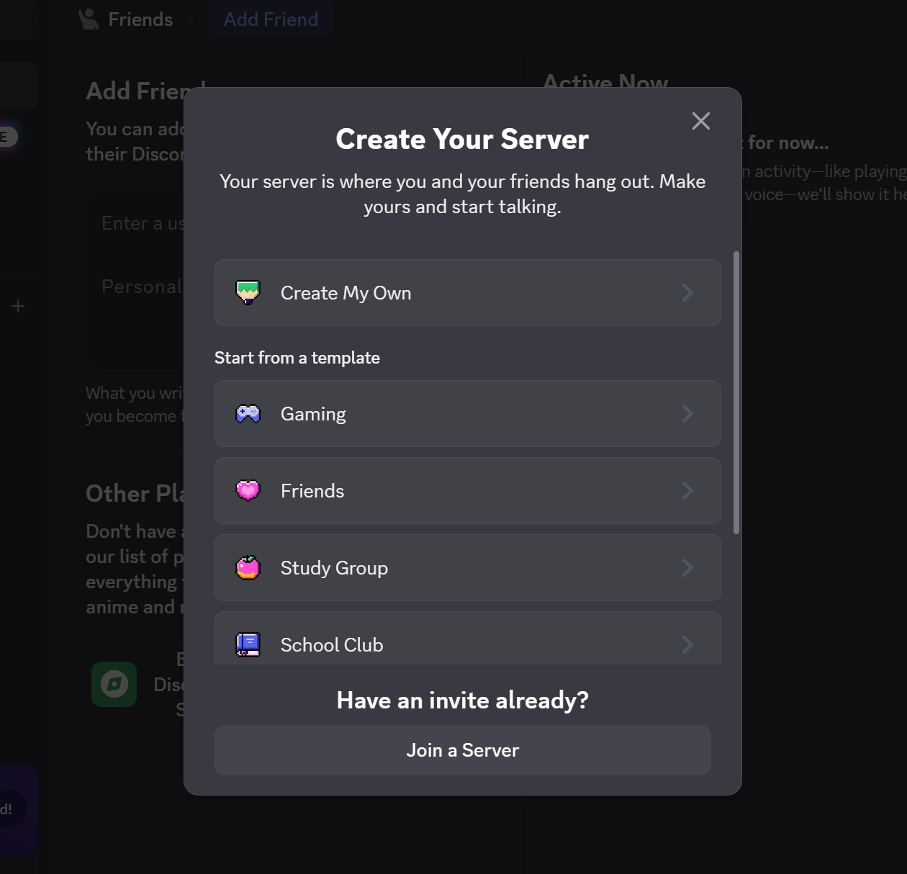

**Customize the server name**  
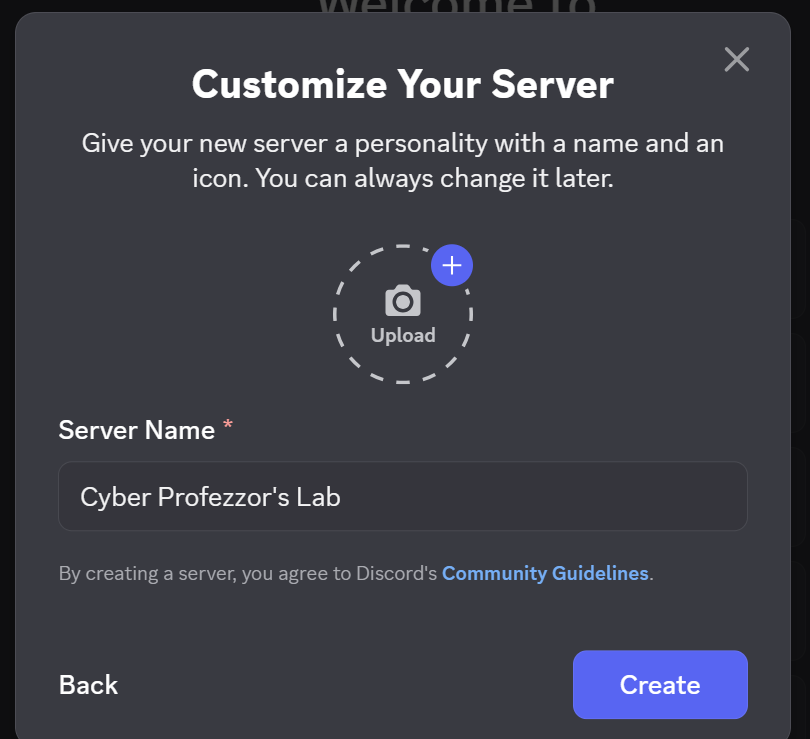

**Confirm successful server creation**  


**Initial server layout and channel navigation**  
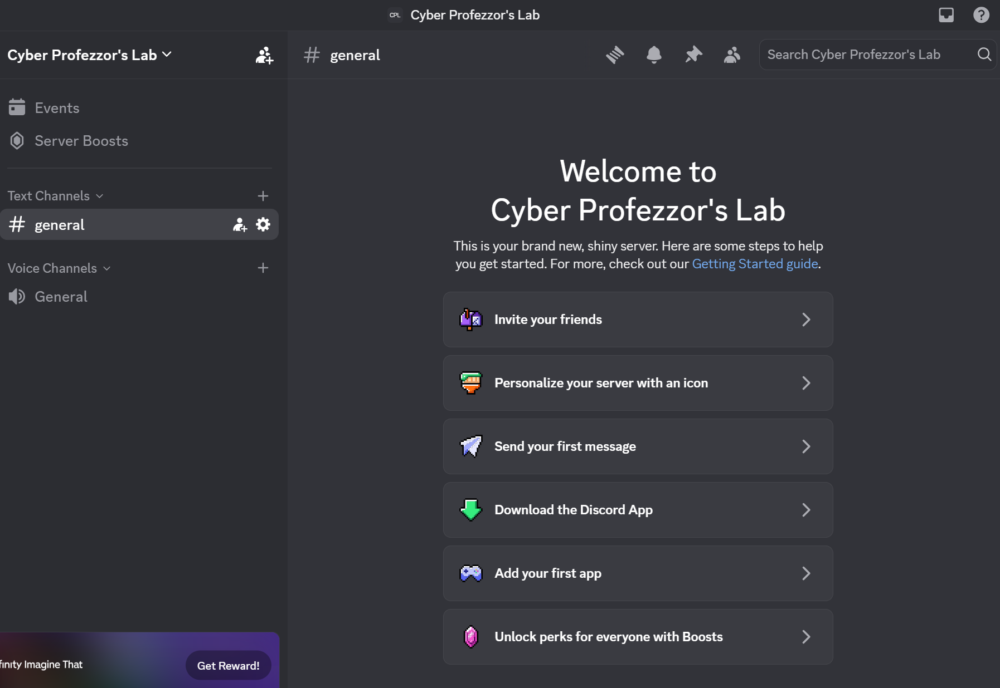

</details>

## 2. Create the `#wazuh-alerts` channel

Next, I created a dedicated **text channel** named `wazuh-alerts` so that incoming security notifications would be separated from general discussion.

The channel was initially created with the default visibility setting. I **later enabled Private Channel** under **Edit Channel → Permissions**, so only specifically authorized members and roles can view the alert messages. In the captured permissions view, the server owner is the only listed member and there are no additional roles.

This protects the alert feed from other server members who have not been granted access; the webhook URL must still be treated as a secret because a valid webhook can post into the channel.

<details>
<summary>View channel creation, settings and private-channel permissions screenshots (4)</summary>

**Create a new text channel for alerts**  
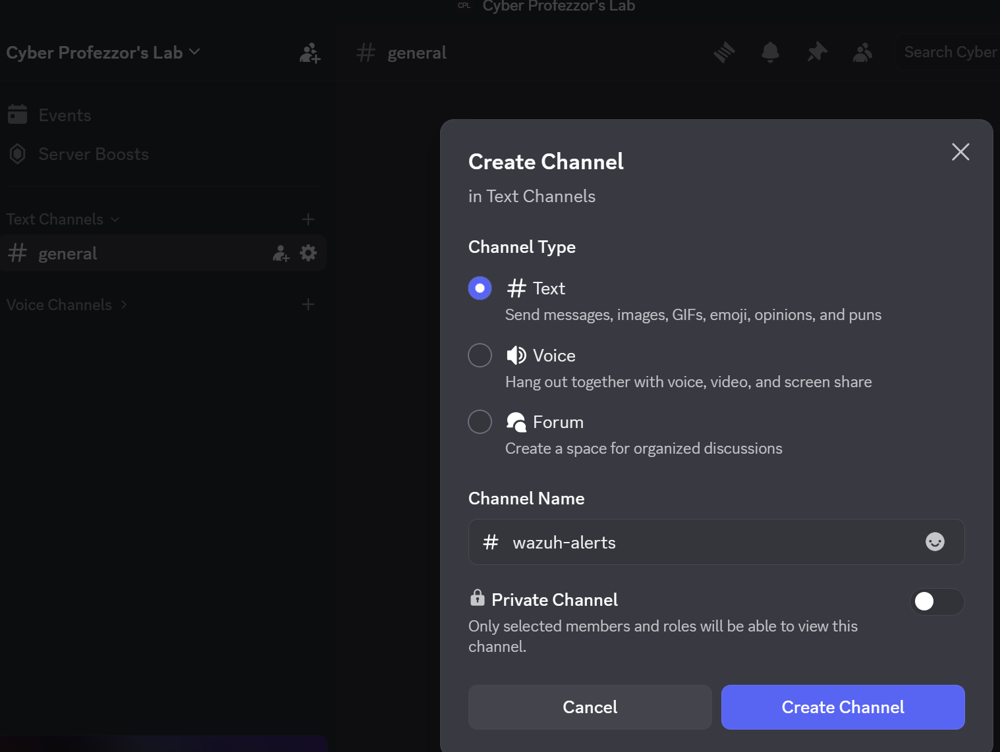

**New channel ready to receive messages**  


**Channel overview and settings**  
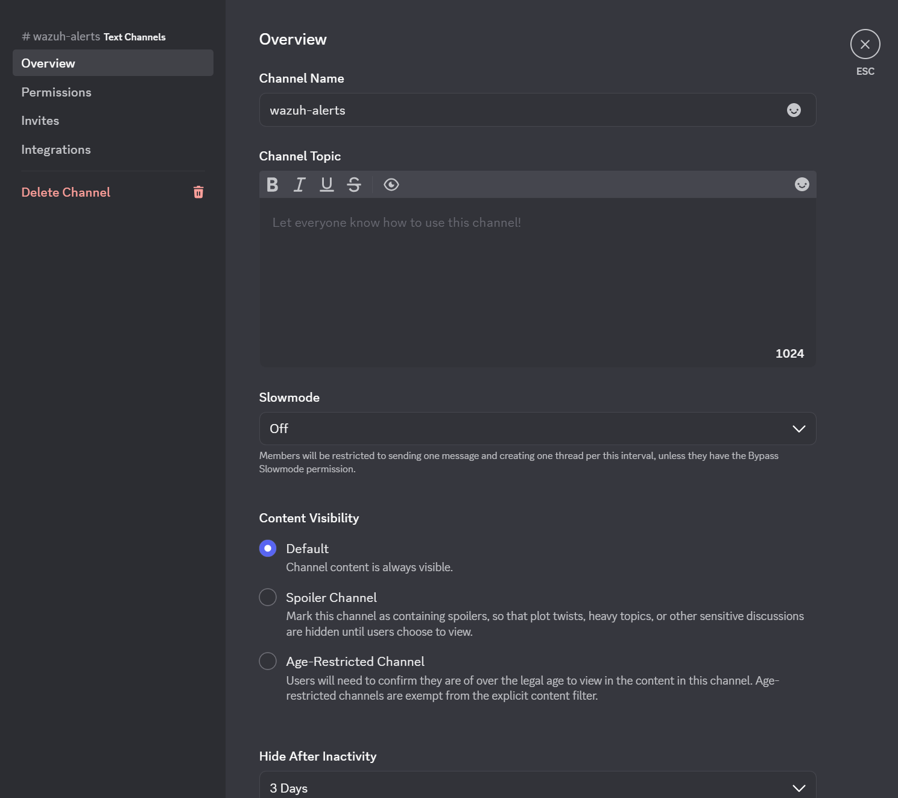

**Restrict alert visibility: Private Channel enabled**  


</details>

## 3. Generate a Discord webhook

From the `#wazuh-alerts` channel settings, I opened **Integrations → Webhooks** and created a webhook associated with the channel. The webhook was renamed **Wazuh** in the screenshots.

A Discord webhook URL acts as a **secret posting credential**: anyone who has the complete URL may be able to send messages to that channel.

<details>
<summary>View webhook configuration screenshots (3)</summary>

**Discord channel integration settings**  


**New webhook created**  


**Webhook named Wazuh, targeting the alert channel**  
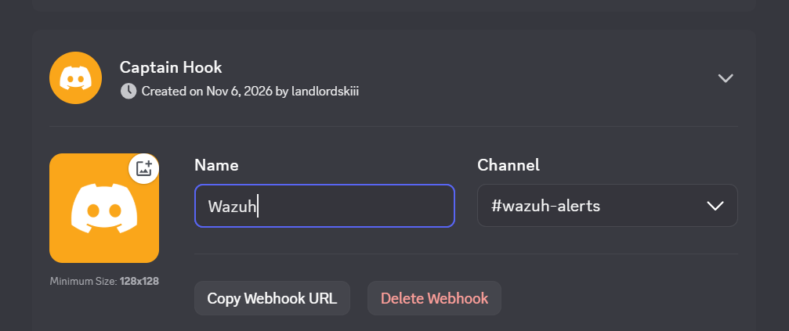

</details>

## 4. Test Discord webhook connectivity from Ubuntu

I used the Wazuh Ubuntu server terminal to confirm that an outbound webhook request could create a message in Discord. I first captured the webhook URL in a shell variable without echoing it to the screen:

```bash
read -rsp "Paste Discord webhook URL, then press Enter: " DISCORD_WEBHOOK
echo
```

For a simple connectivity test, I sent a safe JSON notification using `curl`:

```bash
curl -sS -w '\nHTTP status: %{http_code}\n' \
  -H 'Content-Type: application/json' \
  -d '{"content":"Wazuh lab: test notification from Ubuntu.","allowed_mentions":{"parse":[]}}' \
  "$DISCORD_WEBHOOK"
```

The first attempt showed **`curl: (3) URL rejected: Malformed input to a URL function`** and HTTP status `000`, meaning the request did not successfully reach the webhook. After correcting the pasted URL, the next request returned **HTTP `204`** and the test message appeared in `#wazuh-alerts`.


<details>
<summary>View connectivity troubleshooting and message evidence (2)</summary>

**Initial malformed URL attempt and HTTP 000**  
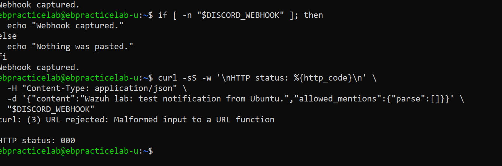

**First test message visible in Discord**  
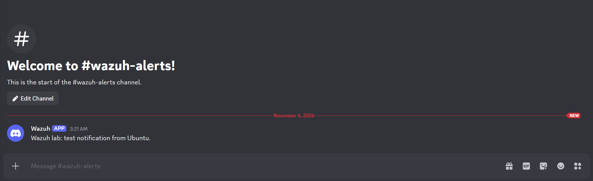

</details>

> A `204 No Content` response is an expected successful response for Discord's default webhook POST behavior. The corresponding message in Discord provides an additional end-to-end confirmation.

## 5. Configure Wazuh custom integration and alert threshold

With webhook connectivity established, I created a custom integration script at:

```text
/var/ossec/integrations/custom-discord
```

I then added an integration block to the **Wazuh manager's** `/var/ossec/etc/ossec.conf` configuration. The XML config identifies the integration and its level threshold; the separate Python executable performs the alert formatting and HTTP delivery. The documentation below uses a placeholder rather than the real webhook URL:

```xml
<integration>
  <name>custom-discord</name>
  <hook_url>REPLACE_WITH_PRIVATE_DISCORD_WEBHOOK_URL</hook_url>
  <level>10</level>
  <alert_format>json</alert_format>
</integration>
```

**What each setting does:**

| Field | Purpose |
| --- | --- |
| `custom-discord` | Matches the custom integration script name |
| `hook_url` | Destination Discord webhook, kept secret |
| `level` set to `10` | Forwards Wazuh alerts of rule level **10 or higher** |
| `alert_format` set to `json` | Passes structured alert data to the integration script |

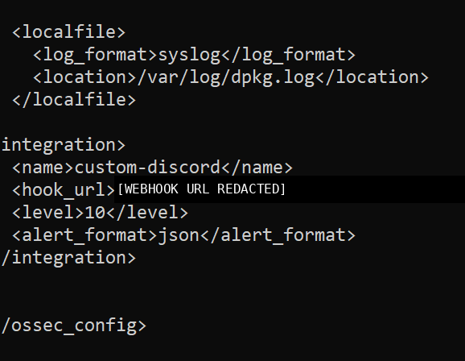

### Python integration script

I implemented the webhook delivery as a small Python program using the standard-library modules `json`, `sys` and `urllib`. The source below is **the script I used in this lab**, shared without a live webhook URL:

**[View the complete `custom-discord` Python integration script](scripts/custom-discord)**

On the Ubuntu Wazuh server, the installed script path is:

```text
/var/ossec/integrations/custom-discord
```

To edit that file using Nano:

```bash
sudo nano /var/ossec/integrations/custom-discord
```

Paste the Python source, press **Ctrl+O → Enter** to save, then **Ctrl+X** to exit. The script must also be executable with appropriate Wazuh integration file permissions; my successful tests verify that the installed copy was runnable, but the exact ownership/permission commands were not captured.

**What the script does:**

1. Reads the JSON alert file supplied by Wazuh from `sys.argv[1]`.
2. Retrieves the Discord webhook URL supplied to the integration as `sys.argv[3]` (not hardcoded in Python).
3. Extracts the rule level, rule ID, description, agent name and timestamp, with fallback values for missing fields.
4. Builds a concise Discord message and caps its content at **1,900 characters**.
5. Sends an HTTP **POST** with a JSON body to Discord, using a 15-second timeout, and reports the HTTP status or a failure.

The payload explicitly sets `allowed_mentions` to an empty list, helping prevent alert content from pinging Discord users or roles. The script does **not** implement the level-10 filter itself; **`<level>10</level>` in `ossec.conf`** controls which Wazuh alerts invoke the integration.


### Restart the Wazuh manager

After modifying the manager configuration, I restarted the service and checked its status:

```bash
sudo systemctl restart wazuh-manager
sudo systemctl status wazuh-manager --no-pager -l
```

The screenshot shows **`wazuh-manager.service` active (running)**, including the Wazuh Integrator process in the process tree.


## 6. Validate the custom integration with a synthetic alert

To test message formatting without waiting for a real detection, I created a temporary JSON alert file. This sample is a **manual test**, not evidence of an actual attack:

```bash
read -rsp "Paste Discord webhook URL, then press Enter: " DISCORD_WEBHOOK
echo

TEST_ALERT=$(mktemp)
cat > "$TEST_ALERT" <<'EOF'
{
  "timestamp": "Manual integration test",
  "agent": {
    "name": "Ubuntu-Lab-Test"
  },
  "rule": {
    "level": 10,
    "id": "TEST",
    "description": "TEST ONLY: Discord integration script is working."
  }
}
EOF

sudo /var/ossec/integrations/custom-discord "$TEST_ALERT" "" "$DISCORD_WEBHOOK"

rm -- "$TEST_ALERT"
unset TEST_ALERT DISCORD_WEBHOOK
```

This invokes the same custom integration executable using the temporary alert file and a webhook URL. The middle empty argument represents an unused API-key argument in this test.

The script returned **`Discord HTTP status: 204`**, and the formatted alert appeared in the Discord channel with agent, rule level, rule ID, description, and time.

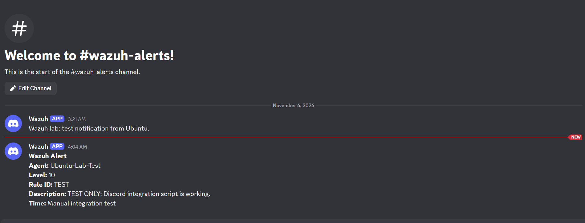

<details>
<summary>View manual integration test terminal and channel screenshots (2)</summary>

**Temporary JSON alert, script invocation, HTTP 204, and cleanup**  
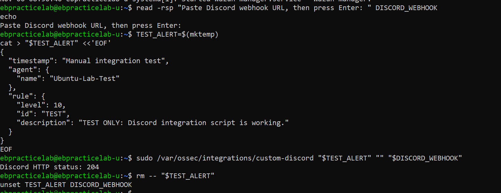

**Manual alert shown alongside the earlier connectivity test**  


</details>

## 7. Verify automatic Wazuh-to-Discord notifications

I subsequently received a test alert **through the Wazuh integration**, rather than only through a manually invoked script. The Discord message included:

| Field | Observed value |
| --- | --- |
| Agent | `ebpracticelab-u` |
| Rule level | **10** |
| Rule ID | `100510` |
| Description | `TEST ONLY: Automatic Wazuh-to-Discord notification.` |
| Timestamp | `2026-11-06T09:22:04.543+0000` |


**Result:** The test demonstrated that a rule-level-10 Wazuh alert could trigger the configured integration and appear in the Discord channel. The `level` filter is designed to include alerts of level 10 and above; I did not independently test every severity level in this exercise.

## 8. End-to-end validation: simulated SSH authentication failures

To confirm that actual Wazuh detections (not only synthetic test alerts) were forwarded, I simulated repeated failed SSH authentication attempts **against my own Ubuntu lab VM** using a deliberately nonexistent username. I ran the commands in the Ubuntu **Bash** terminal, not Windows PowerShell.

First, I verified a single attempt reached the SSH password authentication stage. Earlier attempts stopped at **`Host key verification failed`**, before password authentication. I used SSH's `accept-new` option and a dedicated known-hosts file for this local lab test; after the server key was recorded, the test reached the password prompt and produced `Invalid user` and `Failed password` events. `accept-new` automatically records a previously unseen host key, but does not independently establish the server's identity.

```bash
ssh -o StrictHostKeyChecking=accept-new \
    -o UserKnownHostsFile="$HOME/.ssh/wazuh-lab-known-hosts" \
    -o PubkeyAuthentication=no \
    -o PreferredAuthentications=password \
    -o NumberOfPasswordPrompts=1 \
    -p 22 wazuh_lab_invalid_user@127.0.0.1
```

I entered an intentionally incorrect test password, then checked the SSH service journal for `Invalid user` and `Failed password` events:

```bash
sudo journalctl -u ssh --since "2 minutes ago" --no-pager
```

Once this worked, I repeated the invalid-user attempt **eight times within approximately two minutes**, entering an incorrect password at each prompt:

```bash
for i in {1..8}; do
    ssh -o UserKnownHostsFile="$HOME/.ssh/wazuh-lab-known-hosts" \
        -o PubkeyAuthentication=no \
        -o PreferredAuthentications=password \
        -o NumberOfPasswordPrompts=1 \
        -p 22 wazuh_lab_invalid_user@127.0.0.1
    sleep 2
done
```


### Detection and Discord results

Wazuh correlated the repeated failed logins into **two level-10 alerts**, which were automatically posted to the private `#wazuh-alerts` Discord channel:

| Wazuh rule | Level | Alert observed in Discord |
| --- | ---: | --- |
| `5712` | **10** | `sshd: brute force trying to get access to the system. Non existent user.` |
| `5551` | **10** | `PAM: Multiple failed logins in a small period of time.` |

Both alerts identified the Wazuh Ubuntu manager as `ebpracticelab-u`, included a description and timestamp, and arrived without manually executing the Python script.


**Result:** This validated the complete flow from **SSH authentication events → Wazuh correlation rules → Python custom integration → Discord webhook → private alerts channel**.

### Short troubleshooting note: DNS and outbound connectivity

During initial testing, level-10 alerts were generated but Discord received nothing. Wazuh's `ossec.log` showed the integration being invoked but failing with `URLError`; Ubuntu also failed to resolve external hostnames. Restoring working DNS resolution for the Ubuntu VM using the **VirtualBox NAT DNS service (`10.0.2.3`)** resolved the connectivity issue, and the next live SSH test reached Discord successfully. If notifications stop arriving, check **DNS resolution, outbound HTTPS, and Wazuh integration logs** before changing detection thresholds or rules. This temporary DNS change should be made persistent separately if needed.

## 9. Lessons learned

- A webhook makes it straightforward to deliver Wazuh notifications into a dedicated communication channel without deploying a full ticketing platform.
- **Network/webhook connectivity**, **integration-script execution**, **Wazuh alert generation**, and **automatic alert delivery** are separate stages that must be tested individually.
- The end-to-end SSH test produced two separate level-10 correlation alerts (`5712` and `5551`), confirming that the existing `<level>10</level>` integration threshold operated as configured.
- A threshold of **10+** limits forwarded alerts to higher rule levels, but lower-severity alerts may also be valuable in an investigation.
- **Discord is currently an alert inbox and manual triage workspace**, not a complete ticketing system. Automated case ownership, status tracking, and SLA reporting were not implemented in this lab.

---

### References

- [Wazuh — External API integration](https://documentation.wazuh.com/current/user-manual/manager/integration-with-external-apis.html)
- [Wazuh — Integration configuration reference](https://documentation.wazuh.com/current/user-manual/reference/ossec-conf/integration.html)
- [Discord — Intro to Webhooks](https://support.discord.com/hc/en-us/articles/228383668-Intro-to-Webhooks)

---

**Cyber Profezzor — YouTube Channel**  
Explore my cybersecurity investigations, SOC labs, and hands-on security tutorials.
