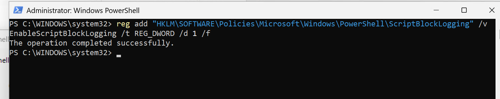
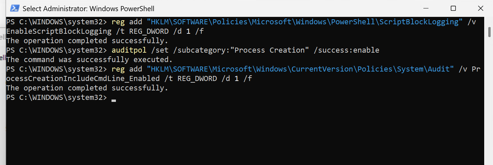
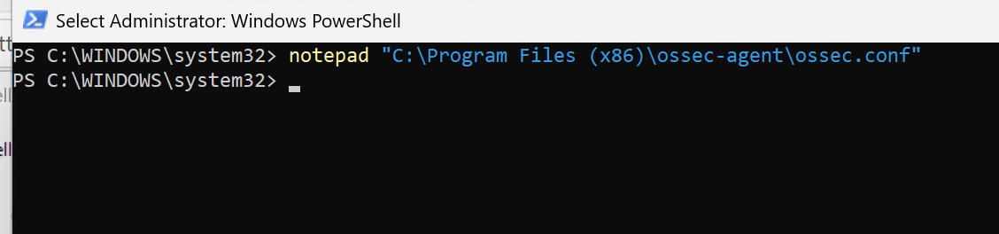
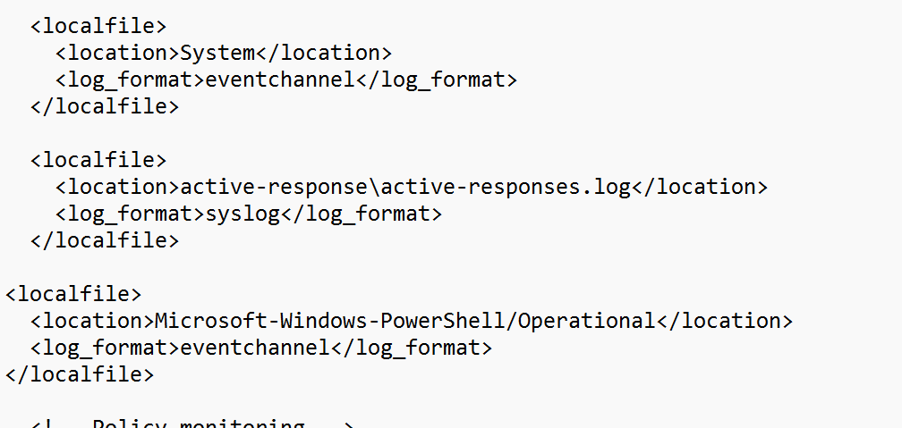
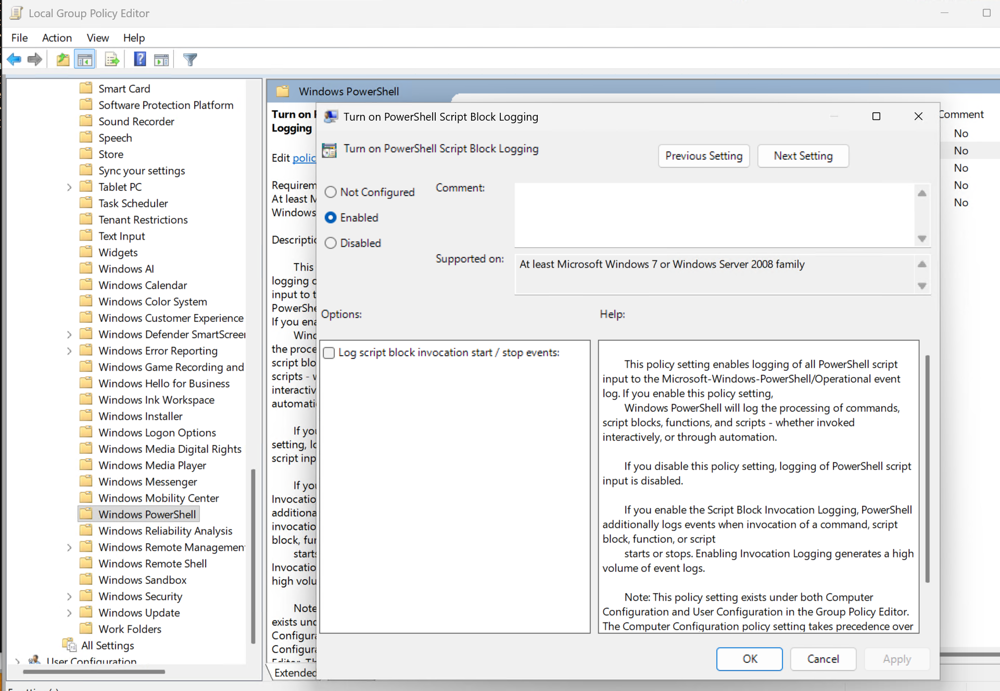
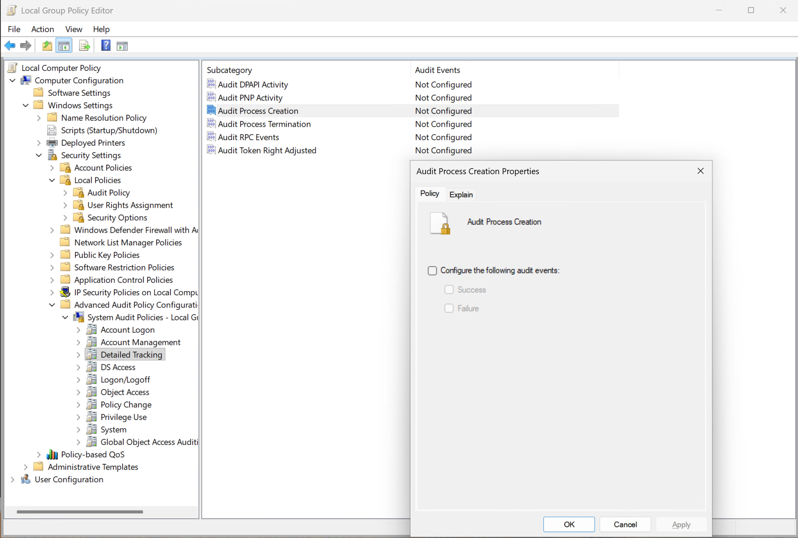
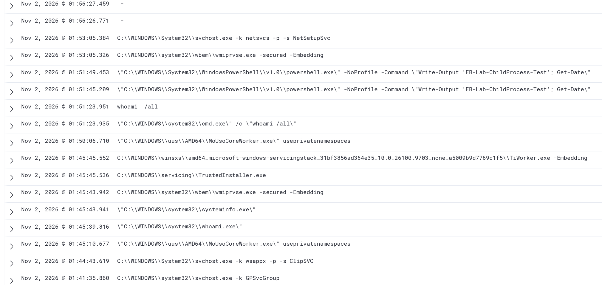
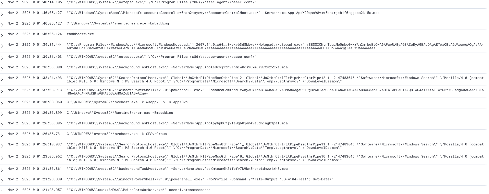
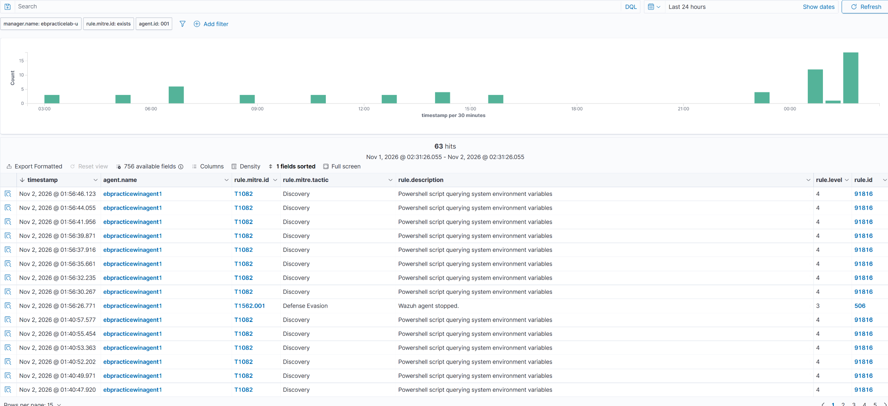

# Wazuh Lab: Process Creation Auditing & PowerShell Script Block Logging

**Status:** Completed lab configuration and initial telemetry verification  
**Environment:** Wazuh SIEM/XDR · Windows 11 Pro Wazuh agent · PowerShell · Local Group Policy  
**Captured:** November 2, 2026  
**Previous lab:** [Wazuh deployment: Ubuntu Server and Windows agent onboarding](../README.md)

> **Project summary:** After installing the Wazuh server and onboarding my Windows 11 virtual machine, I enabled Windows process creation auditing, command-line capture, and PowerShell Script Block Logging. I configured the Wazuh agent to collect the PowerShell operational event channel, refreshed policy, restarted the Wazuh service, and examined newly available process/PowerShell activity in Wazuh Discover.

## Objectives

- Record process creation events, including executable command lines, using Windows Security **Event ID 4688**.
- Enable PowerShell Script Block Logging for **Event ID 4104** in the **Microsoft-Windows-PowerShell/Operational** channel.
- Make sure the Windows Wazuh agent collects the relevant event channels.
- Verify visibility of benign test commands and MITRE ATT&CK-mapped PowerShell detections.
- Document both the PowerShell command-line method I used and the equivalent Group Policy interfaces.

## 1. Enable PowerShell Script Block Logging (4104)

I opened an **elevated PowerShell session** on the Windows 11 VM and enabled script block logging using the registry:

```powershell
reg add "HKLM\SOFTWARE\Policies\Microsoft\Windows\PowerShell\ScriptBlockLogging" /v EnableScriptBlockLogging /t REG_DWORD /d 1 /f
```

Script Block Logging can capture PowerShell script content for investigations. **4104 is logged under the PowerShell Operational channel, not the Windows Security log.**



## 2. Enable Process Creation and Command-Line Auditing (4688)

I ran these two commands **separately** in elevated PowerShell.

Enable process creation auditing:

```powershell
auditpol /set /subcategory:"Process Creation" /success:enable
```

Include the command line in process creation events:

```powershell
reg add "HKLM\SOFTWARE\Microsoft\Windows\CurrentVersion\Policies\System\Audit" /v ProcessCreationIncludeCmdLine_Enabled /t REG_DWORD /d 1 /f
```

These settings make Windows Security Event ID **4688** more useful during investigations by providing process creation details and, when available, the associated command line.



## 3. Configure Wazuh to collect PowerShell events

Next, I opened the Wazuh agent configuration file:

```powershell
notepad "C:\Program Files (x86)\ossec-agent\ossec.conf"
```



I added the following event channel collection entry inside `<ossec_config>`, alongside existing `<localfile>` entries, **only if it was not already present**:

```xml
<localfile>
  <location>Microsoft-Windows-PowerShell/Operational</location>
  <log_format>eventchannel</log_format>
</localfile>
```



**Note:** Process Creation Event ID 4688 comes from the Windows **Security** channel, which also needs to be collected by the Wazuh agent. The PowerShell `<localfile>` block above is for Event ID 4104, not for Event ID 4688.

## 4. GUI alternative using Local Group Policy

Although I performed these changes using PowerShell, I also captured the GUI settings.

### PowerShell Script Block Logging

Open `gpedit.msc` and navigate to:

**Computer Configuration → Administrative Templates → Windows Components → Windows PowerShell → Turn on PowerShell Script Block Logging**.

Choose **Enabled**. The separate *Log script block invocation start / stop events* option is not required to record normal Event ID 4104 script blocks and can substantially increase log volume.



### Audit Process Creation

Navigate to:

**Computer Configuration → Windows Settings → Security Settings → Advanced Audit Policy Configuration → System Audit Policies → Detailed Tracking → Audit Process Creation**.

Enable **Success** auditing to generate Event ID 4688 when processes are created.



The command-line inclusion policy can also be configured through **Administrative Templates → System → Audit Process Creation → Include command line in process creation events**.

## 5. Refresh policy and restart the Wazuh service

After applying the changes, I refreshed Group Policy:

```powershell
gpupdate /force
```

After saving `ossec.conf`, I restarted the Wazuh agent service on the Windows VM so it would pick up the updated collection configuration:

```powershell
Restart-Service WazuhSvc
```

I could also restart the endpoint if needed for a particular change to take effect. When editing XML, I avoided adding duplicate channel entries.

## 6. Validate the new process and PowerShell telemetry in Wazuh

After the changes, I used benign discovery and PowerShell test commands to verify collection. The Wazuh Discover view now displayed process command lines such as:

- `whoami /all` and `cmd.exe /c whoami /all`
- `systeminfo.exe`
- `powershell.exe -NoProfile -Command "Write-Output 'EB-Lab-ChildProcess-Test'; Get-Date"`
- A PowerShell `-EncodedCommand` example from lab testing
- `notepad.exe` opening the Wazuh agent configuration file





### MITRE ATT&CK visibility

I also examined Wazuh results filtered for MITRE-mapped alerts from agent `001`. The screenshot shows **63 hits** in the selected time window, including entries with:

| Field | Observed example |
| --- | --- |
| `rule.mitre.id` | `T1082` |
| `rule.mitre.tactic` | Discovery |
| `rule.description` | Powershell script querying system environment variables |
| `rule.level` | 4 |
| `rule.id` | 91816 |

One visible alert also indicates that the **Wazuh agent stopped**, mapped in the displayed data to Defense Evasion (T1562.001). This is not, by itself, evidence of an attacker: the service was intentionally restarted during configuration.



## 7. Outcome and lessons learned

The lab successfully improved the Windows telemetry available for Wazuh investigations:

- **Process creation auditing:** Enabled; executable command lines became visible in Wazuh.
- **PowerShell Script Block Logging:** Enabled via Windows policy and the Operational channel configured in Wazuh.
- **Event collection:** The Wazuh agent was restarted to pick up the new event channel configuration.
- **Detection context:** Discover showed benign testing activity and Wazuh alerts mapped to MITRE ATT&CK.

The main lesson was that **SIEM visibility depends on both endpoint audit policy and sensor/agent collection configuration**. Enabling a Windows log is not the same as confirming that the SIEM has ingested and indexed it.

## 8. Continuing the lab: Forwarding Wazuh alerts to Discord

After enabling additional Windows logging and reviewing the telemetry in Wazuh, I continued by setting up **automatic Wazuh alert forwarding to Discord**.

I created a private `#wazuh-alerts` channel, configured a Python `custom-discord` integration on the Ubuntu Wazuh manager, and validated notifications for level-10 SSH and PAM authentication alerts.

**[Read the next lab: Wazuh SIEM/XDR — Forwarding Security Alerts to Discord](../discord-alert-forwarding/README.md)**

---

**Security and privacy note:** Script Block Logging and command-line auditing can capture sensitive values passed as arguments or entered in scripts. Consider log access controls, retention, and credential hygiene before enabling these settings outside a personal test environment.

---

**[Cyber Profezzor — YouTube Channel](https://www.youtube.com/@thecyberprofezzor)**  
Explore my cybersecurity investigations, SOC labs, and hands-on security tutorials.
