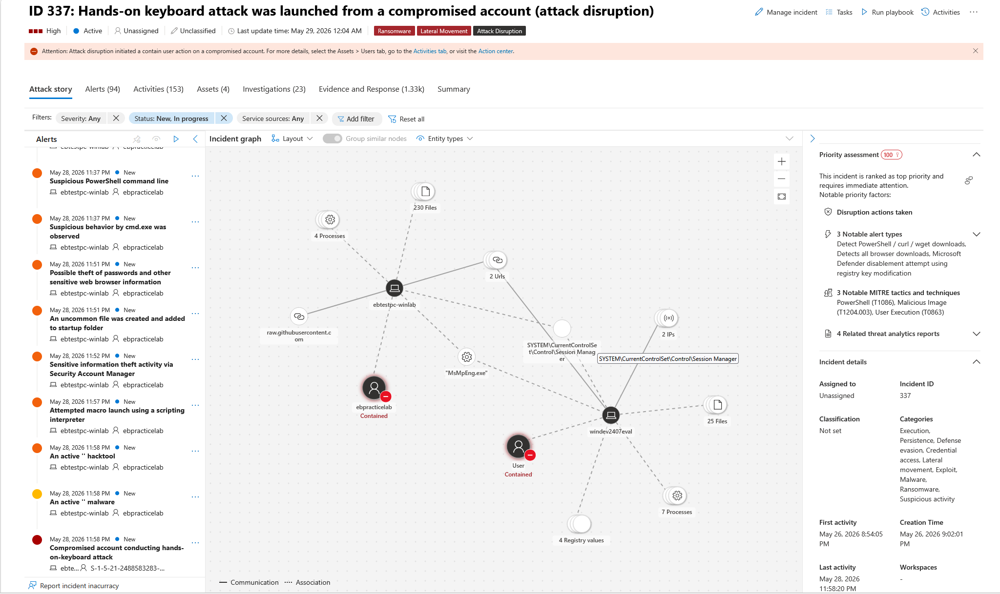
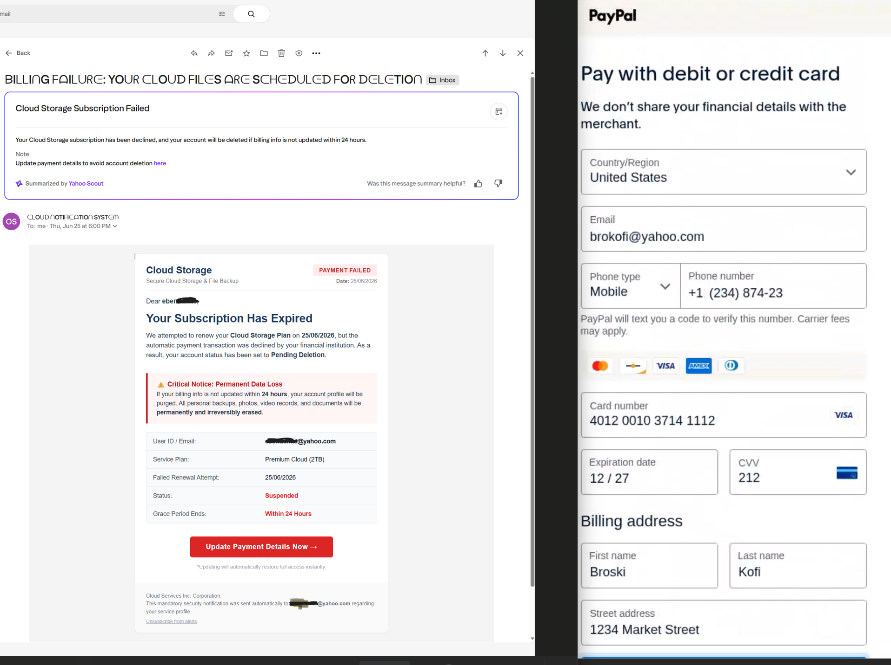

# Original Google Sites Home content

Hey all, I’m Ebenezer Yiadom - SOC Analyst. Welcome to my digital workspace.

This portfolio is a live documentation of my hands-on lab work, continuous practice, and evolving engineering projects. I built this space to showcase practical applications of cybersecurity concepts, moving beyond theory into real-world threat hunting and log analysis.

What you'll find here:

- SOC Lab Development: Architecting and tuning robust environments using Microsoft Sentinel and Defender XDR.
- Telemetry & Threat Simulation: Ingesting real telemetry from virtual machines and running advanced simulations with Atomic Red Team to sharpen my detection skills.
- Looking Ahead : Deep dives into incident response and practical malware analysis.

This portfolio will evolve as my skills do. While security operations are at the forefront of my work right now, expect to see me dive into some other technical projects in the near future.

## Featured Labs

[Atomic Red Team Simulation & Detection](README.md)

[Cloud Storage Phishing Email Header Analysis](README.md)

### [Custom Analytic Rule & Detection](README.md)

YouTube Channel

[Cyber ProfezzorLet's learn all about cyber security! We are going to learn, re-learn, break things and try to fix them! We are also going to learn how to protect ourselves against online scams for ourselves and family!. Legooooooo!](https://www.youtube.com/channel/UCn6AE1MRHnY8OuJQx_lX8wQ)

## Get in touch at ebenezeryiadom@gmail.com
